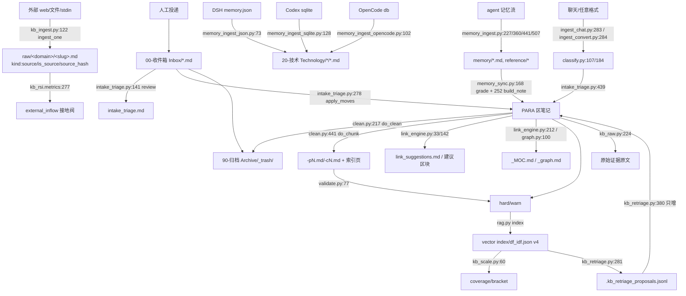

# C 组（摄取 / 清洗 / 分块 / 去重 / 链接 / 记忆摄取）逐文件全文精读报告

- 项目根：`/home/mushan/workspace/kb-kit-pure`
- 代码主体：`template-vault/pipeline/`
- 精读范围：22 个文件，共 **6715 行**（本报告所有行号均指当前工作区文件的实际行号）
- 辅助精读（为结论提供交叉证据）：`kb_common.py`(1213 行，全文)、`kb_constants.py`(88 行，全文)、`taxonomy.py`(104 行，全文)、`state_manager.py`(167 行，全文)、`kb_rsi.py`(1–330 行)、`kb_launcher.py`(1–330 行)、`plugins/*_plugin.py`、`plugins/_subprocess_plugin.py`、`scripts/growth_cron.sh`、`docs/write-side-protocol.md`、`reference/*.json`
- 只读纪律：本报告未修改任何代码。为验证两处高危行为，在 `/tmp/kbcheck/` 的**副本**上做了受控实验（见 §七 P0-1/P0-3/P0-4 的"实测"），原始工程目录未被写入。
- 本报告约定：`未确认` 表示无法从代码与现场文件确证。

---

## 一、本组在整体数据流中的位置：从收件箱到索引的完整流转链

### 1.1 位置概览

kb-kit 的数据流是"**外部真值 → 收件箱 → 分诊 → 清洗/分块 → 去重/建链 → 索引 → 检索**"，本组覆盖其中的**全部写侧入口**（除 `curate.py` 的知识结晶外）。上游是人工投递、agent 记忆流与外部网页；下游是 `rag.py` 的 `vector index/df_idf.json`（非本组，实测 version=4、n_docs=30）、`kb_health*`/`kb_audit` 巡检、`kb_query`/`rag query` 检索。

**关键事实：本组模块的 CLI 接线并不完整。** `kb_launcher.py` 的 `COMPAT_MAP`（1–186 行）中，本组有映射的只有 `intake`(ingest)、`clean`、`link`、`raw`、`validate`、`tagfix`、`contextual`、`graph`、`sync`、`memory_sync`；**`kb_ingest.py`、`kb_scale.py`、`kb_retriage.py`、`semantic_chunk.py`(仅作为插件 action)、`dedup.py`、`memory_ingest*.py`(仅经 `agent_registry`)** 未直接出现在 `COMPAT_MAP` 中（`kb_ingest.py` 连 plugin wrapper 都没有，全库 grep 仅其自身文件命中）。定时编排 `scripts/growth_cron.sh` 依次调用：`rag index → intake_triage review → feedback ingest → recall deck → link_engine suggestions → dashboard → memory_ingest(mirror-core/mirror/extract/sync) → agent_registry ingest → memory_sync promote --apply → [curate]`——**它不调用 `clean.py`，也不调用 `kb_ingest.py`**。

### 1.2 逐步流转链（输入文件 → 处理函数 `文件:行` → 输出文件/字段变更）

| # | 输入 | 处理函数（文件:行） | 输出 / 字段变更 | 触发方式 |
|---|---|---|---|---|
| ① | `--url` / `--file` / `--stdin` / `--dir` | `fetch_url` `kb_ingest.py:45`、`read_file:66`、`read_stream:77`；`slugify:89` | 待写目标 `raw/<domain>/<slug>.md` | 手工 CLI（未接 `kb`） |
| ② | 待写正文 | `content_fingerprint` 去重 `kb_ingest.py:124-133` → `ingest_one:122` | 命中则跳过；否则写 `stamp_frontmatter:97`：`title/kind:source/is_source:true/kb_source/domain/created/ingest_time/source_format/url/source_hash` | `--dry` 只算不写 |
| ③ | `raw/**/*.md` | `kb_rsi.collect:158` + `metrics:189` | `external_inflow`（30 天内新鲜外部源占比 `kb_rsi.py:277-282`）→ 是 L0/L2 的"接地阀"锚 | RSI 只读探针 |
| ④ | 收件箱 `00-收件箱 Inbox/*.md` | `intake_triage.triage:141` → `evaluate:73`（四维评分：结构/密度/唯一/价值 `:89-116`） | 报告 `intake_triage.md`（`main:399`） | `kb ingest` = `review` |
| ⑤ | 同上 | `apply_moves:278` | route→`_safe_place:212` 移动到 `kb_target` 区（`:299`）；merge→目标追加 `## 合并自`（`:320-322`）+ 墓碑 `90-归档 Archive/_trash/<stem>-merged-<date>.md`（`:336`，字段 `status:archived/kb_action:retire/redirect_to/merged_from`）+ `aliases`（`:324`）+ `lineage`（`:340`）；trash→`90-归档 Archive/_trash/`（`:349`）；refine→`70-知识治理 Governance/_review/`（`:363`） | `kb ingest move/trash` |
| ⑥ | agent 日报 `*.md` | `memory_ingest.mirror:227` | `memory/<name>.md`，补 `kb_source/memory_source/memory_ingested/source_hash`（`:250-253`）+ 必填 `status/domain/created/updated/importance/tags`（`:255-260`） | cron ⑦ / `kb ingest agent` |
| ⑦ | agent 日报（带 `kb_target`） | `memory_ingest.sync:360` | 目标区文件：新文件写 frontmatter（`:420-423`，**不含 kb_target**）；已存在则按 `replace_sim/merge_sim` 覆盖/追加（`:404-416`） | cron ⑦ |
| ⑧ | agent 核心文件 | `memory_ingest.mirror_core:441` | `reference/<agent>-<FILE>`（`:468`），`kb_target: reference`（`:465`） | cron ⑦ |
| ⑨ | `MEMORY.md`/`USER.md` | `memory_ingest.extract:507` → `extract_entries:577` | `<DOMAIN_BUCKET 区>/<slug>-<MMDD>.md`（`:529-531`），`importance:0.6`、`kb_source/memory_source`（`:536-540`） | cron ⑦ |
| ⑩ | `memory/*.md` | `memory_sync.grade:168`（硬门 ④增量⑤密度+长度；软门 ①②③）→ `build_note:252` | `<FOLDER_TARGET>/<slug 源名+标题>.md`（`:254`），字段见 `:258-272`；账本 `.kb/promotions.jsonl`（`:286`） | `kb memory-sync promote --apply` |
| ⑪ | DSH/Codex/OpenCode 记忆库 | `memory_ingest_json.ingest:73` / `memory_ingest_sqlite.ingest:128` / `memory_ingest_opencode.ingest:102` | 直接写 `kb_target` 文件；已存在则**只追加 `## 标题（日期）` 段落**（json:126 / sqlite:173 / opencode:146） | cron ⑦b / `kb ingest agent` |
| ⑫ | 任意格式文件 | `ingest_convert.convert:284`（TXT/CSV/HTML/EML/JSON 零依赖；PDF/DOCX/XLSX/PPTX 外部工具）+ 镜像 `_save_mirror:32` | 返回 markdown 字符串（本身不落盘） | `kb ingest-any`（`sync.cmd_ingest_any:148`） |
| ⑬ | 聊天导出 | `ingest_chat.parse_chat:283` → `_segment:222` → `_classify_segment:259` | `ChatNote` 列表（含 `participants/chat_time/channel/source_format`），不落盘 | 手工 / plugin `ingest_chat` |
| ⑭ | 正文 | `classify.classify:107` / `classify_quality:184` | `content_type`(12 类)/`quality_score`/`should_ingest` | 被 ⑫⑬ 调用 |
| ⑮ | `content_type` | `intake_triage.triage_by_content_type:439` | direct/aggregate/trash 决策（`CONTENT_TYPE_ROUTES:413`） | 仅 `sync.cmd_ingest_any:178` 调用 |
| ⑯ | 聚合桶 | `kb_common.aggregate_bucket:1124` | `00-收件箱 Inbox/_aggregated/<YYYY-MM>-chat\|todo.md` | `ingest-any` 的 aggregate 分支（`sync.py:190`） |
| ⑰ | 全库笔记 | `clean.clean_note:173` | **整体重建 frontmatter**：`tags/status/domain/created/updated/importance/kb_target/kb_action/kb_summary`（`:194-202`）；`is_index_stub` → `kb_layer:index`+`is_chunk_index:true`（`:204-206`） | `kb clean apply` / `refine` |
| ⑱ | 全库笔记 | `clean.do_clean:217` | 精确去重（NFKC 归一指纹 `_norm_body:49`）→ 归档 + `aliases` + `lineage`（`:238-262`） | `apply`/`refine` |
| ⑲ | 超长笔记(>2000 字) | `clean.do_chunk:441`（有 `##` → `-pN.md`+父索引 `:471-503`；无 `##` → `semantic_chunk.chunk:228` → `-cN.md` + `-index.md` `:504-539`） | 子块 `tags+chunk/chunk_of`，父页 `tags+[toc]/is_chunk_index/kb_layer:index` | `kb clean chunk` |
| ⑳ | 历史残留 | `clean.do_repair:386`（占位符 `{name}·块{i}`、索引页打标）、`do_repair_headings:361`（`## ## ` 去重） | `kb_summary`/`is_chunk_index`/`kb_layer`；正文标题 | `repair`/`repair-headings --apply` |
| ㉑ | tags | `clean.do_taxonomy:72`（`taxonomy.normalize_tags:84`）、`tag_fix.fix:86` | `tags` 归一/删路径型/别名归一 | `clean taxonomy`/`kb tagfix fix` |
| ㉒ | 全库笔记 | `link_engine.suggestions:33`（倒排候选 + 分域/跨域 `candidate_pairs`） | `link_suggestions.md`（`main:275`） | cron ③ 只读 |
| ㉓ | 建议对 | `apply_links:142` | 追加 `## 🔗 智能建议链接` 区块（`:177-192`），无 frontmatter 变化 | `kb link apply` |
| ㉔ | 全库 | `link_engine.moc:212` | `70-知识治理 Governance/_MOC.md`（含 frontmatter，`aliases`） | `kb link moc` |
| ㉕ | 关系字段 | `graph.generate_graph:100` | `70-知识治理 Governance/_graph.md`（Mermaid，**无 frontmatter**） | `kb graph` |
| ㉖ | 全库 | `validate.main:173` / `validate_file:77` | 只读报告/JSON（`hard_issues`），被 `clean.apply/refine`（`:626-633`）与 `sync`（`:40-46`）调用 | `kb validate` |
| ㉗ | 全库笔记 | `rag.py index`（非本组） | `vector index/df_idf.json`（v4） | cron ⑥ |
| ㉘ | 索引文件 | `kb_scale.fabric:60` | `{markdown_docs,indexed_docs,coverage,index_version,bracket,switch_ready,note}` | 手工 CLI |
| ㉙ | L1 漏检 `(query,note)` | `kb_retriage.propose:281`（接 `kb_adaptretrieve`，`:146`） | `.kb_retriage_proposals.jsonl`（`:370`）；`apply:380` 只增写回 `tags`+`kb_summary` | `report/propose/apply` |
| ㉚ | 正向失败链路 | `sync.cmd_apply:90`（校验硬错误→`reset --hard` 回滚 `:99-103`） | `<PARA 区>/<子域>/<date>-<stem>.md`（**无 frontmatter**，`：104-109`） | `kb sync apply <note>` |
| ㉛ | 任意文件 | `sync.cmd_ingest_any:148` | 格式归一→分类→质量门禁→路由→写入（`：156-217`）；聚合分支走 `aggregate_bucket` | `kb ingest-any` |
| ㉜ | 证据层 ID | `kb_raw.resolve:224` / `cmd_show:273` / `cmd_find:139` / `cmd_list:193` | 只读返回原文/清单（可 `--json`） | `kb raw *` |

### 1.3 链路图（本组涉及的写侧）

---

## 二、逐文件详解

> 每文件给出：行数 | 职责 | 关键函数/类（完整签名 + 行号）| 关键常量/阈值 | CLI 参数（全部）| 读写路径规律 | 上下游 | 是否写操作 | 幂等/可重入。

### 2.1 `template-vault/pipeline/kb_ingest.py`（207 行）

- **职责**：外部素材 → `raw/` 不可变证据层（RSI 外部接地阀的真值入口）。
- **关键函数**：
  - `def fetch_url(url)` `:45` — urllib 抓取 + 正则 HTML→md（`:48` User-Agent `kb-kit-rsi-ingest/1.0`，timeout 30s；`:56-57` 去 script/style/head/footer/nav）。
  - `def read_file(path)` `:66` — `.md` 用 `load_note` 剥掉自身 frontmatter，只留正文；其他取全文。
  - `def read_stream(text)` `:77` — 取首个 `#` 标题当 title。
  - `def slugify(title, domain)` `:89` — `SLUG_RE` 归一 → `raw/<domain_slug>/<base[:70]>.md`。
  - `def stamp_frontmatter(kb_source, domain, url, title, body, source_format="md")` `:97` — 生成 11 个字段（`:99-110`）。
  - `def git_commit(root, rels, msg)` `:114` 与 `pre-ingest checkpoint` `:146-150`。
  - `def ingest_one(root, target: Path, body: str, kb_source, domain, url, dry)` `:122`。
  - `def main()` `:159`。
- **常量/阈值**：`RAW_TOP="raw"` `:38`、`DEFAULT_DOMAIN="外部"` `:39`、`SLUG_RE` `:40`、`MAX_BODY=200000` `:41`（注释说"字节"，代码按字符切片 `:123`）、`source_hash` 取 sha256 前 24 字符 `:109`。
- **CLI**：互斥必选 `--url|--file|--stdin|--dir` `:161-165`；`--domain`(默认 外部) `:166`；`--root` `:167`；`--dry` `:168`。
- **读写**：写 `raw/<domain>/<slug>.md`（撞名 `-2/-3`，`:139-143`）；同目录**内容级去重**（`content_fingerprint` 比对，`:128-133`）；`git add -u` + commit（`:146-153`）。读 stdin/任意路径/目录。
- **上下游**：上游=人工/脚本；下游=`kb_rsi.metrics`/`kb_scale`（external_inflow）、`kb_raw` 取原文。**未被 `COMPAT_MAP` 或 plugin 接入**（`:161` 之后仅 argparse）。
- **写操作**：是（写 `raw/` 新文件 + git commit）。
- **幂等/可重入**：幂等（内容指纹命中跳过，`:128-133`）；`--dry` 无副作用；但 `git_commit` 不检查 returncode（`:115-119`），git 不可用时静默无回滚点。

### 2.2 `template-vault/pipeline/kb_raw.py`（353 行）

- **职责**：证据层（`raw/` + `memory/`）原文按需取回；只读。
- **关键函数**：`_read:37`、`_is_evidence:44`、`_walk:53`（**`os.chdir` 到 root 再相对遍历**）、`_evidence_files:68`、`_agent_roots:77`（读 `kb-agent.json`/`.kb-agent.json` 的 `sources.*`）、`_build_id_map:108`（ID=`memory_source`/`kb_synced_from`/`kb_source` 或相对路径，一对多）、`cmd_find(root, needle, limit, context, as_json):139`、`cmd_list(root, as_json):193`、`resolve(raw_id, root) -> (Optional[Path], List[str]):224`、`cmd_show(root, raw_id, lines, full, path_only, as_json=False):273`、`main():319`。
- **常量**：`EVIDENCE_DIRS=("raw","memory")` `:31`、`DEFAULT_HEAD=40` `:32`、`FM_ID_KEYS=("memory_source","kb_synced_from","kb_source")` `:33`。
- **CLI**：`show <id> --root --lines --full --path-only --json` `:322-326`；`find <q> --root --limit(20) --context(2) --json` `:327-329`；`list --root --json` `:330-331`；`path <id> --root` `:332`。
- **读写**：只读；ID 解析顺序 = `vault:<rel>` 别名 → 相对路径 → `raw/_curated/<rel>` 保号副本 → ID 映射 → 子串模糊（唯一命中才返回）→ agent 源根 `rglob`（`:231-269`）。
- **上下游**：上游=`kb_ingest`/`curate` 写下的证据层；下游=Agent 管道（`--path-only`/`--json`）、`kb_query` 溯源。
- **写操作**：否。
- **幂等/可重入**：天然幂等；但 `_walk` 改进程 CWD（`:59-65`）→ 并发/多线程竞态；`cmd_find` 每次调用要全库 walk 两次（`:149` + `:152`）。

### 2.3 `template-vault/pipeline/clean.py`（670 行）

- **职责**：知识库清洗/结构化归一/精确去重/分块/历史残留修复。文件头 `:16-20` 自述已被 RSI 取代，但 `aggregate_bucket/fmt_value` 等仍被复用。
- **关键函数**：
  - `_norm_body(body: str) -> str` `:49`（NFKC + 空白压缩）
  - `_rewrite_tags(text: str, tags: List[str]) -> Optional[str]` `:54`
  - `do_taxonomy(root, dry) -> Tuple[List, List[str]]` `:72`
  - `route_chunk_strategy(body: str) -> str` `:96`（**无调用方**）
  - `tokens(s: str) -> List[str]` `:120`（**无调用方**）
  - `_parse_importance(v)` `:128`（默认 0.5）
  - `git(args, cwd)` `:140`、`checkpoint(root) -> str` `:144`、`_stage_paths(root, paths) -> List[str]` `:152`
  - `clean_note(root, p: Path) -> Tuple[str, str]` `:173`
  - `do_clean(root, dry) -> Tuple[List[str], int, Counter, List[str]]` `:217`
  - `report(root) -> int` `:270`
  - `_is_raw_rel(rel) -> bool` `:334`、`strip_duplicate_heading(text) -> Tuple[str,int]` `:344`
  - `do_repair_headings(root, dry=True, include_evidence=False) -> Tuple[int, List[str]]` `:361`
  - `do_repair(root, dry=True) -> Tuple[int,int,List[str]]` `:386`
  - `do_chunk(root, limit) -> Tuple[int, List[str]]` `:441`
  - `main() -> int` `:544`
- **常量/阈值**：`BODY_LIMIT=2000` `:42`、`ARCHIVE_DAYS=90` `:43`、`STATUS` `:44`、`REQUIRED`（9 字段）`:45-46`、`PLACEHOLDER_RE` `:340`、`trash` 目录 `90-归档 Archive/_trash` `:238`、分块阈值来自 `--threshold`（默认 `BODY_LIMIT`）。
- **CLI**（8 个子命令，`:547-561`）：`dry-run`、`apply`、`chunk --threshold`、`report`、`taxonomy --apply`、`refine --threshold`、`repair --apply`、`repair-headings --apply --include-evidence`；均带 `--root`。
- **读写**：读全库 `iter_notes`；写：全库 frontmatter 重写（`clean_note`）、`90-归档 Archive/_trash/<stem>-dup-<date>.md`（`:245-252`）、`-pN.md`/`-cN.md`/`-index.md`、`clean_suggestions.md`（`:330`）、`.kb/state/lineage.jsonl`（经 `record_lineage`）。**注意 `iter_notes` 不排除 `raw/`**（`kb_common.py:28-30` 的 `EXCLUDE` 无 `raw`）。
- **上下游**：上游=`intake_triage`/`memory_*` 的产物；下游=`rag index`、`validate.py`（`:626-633`）、`curate`；`aggregate_bucket/fmt_value` 被 `sync.py:181` 复用。
- **写操作**：是，且是全组**最激进**的写者（重写每条笔记 frontmatter）。
- **幂等/可重入**：多数幂等（`_stage_paths` 容忍已删路径、分块有 `chunk_of/is_chunk_index` 跳过 `:452-462`、repair 幂等）；但 `clean_note` 每次运行都会重排 frontmatter 键序、丢弃空值键、覆盖 `kb_summary`（见 §七 P0-2/P0-3/P1-13）。

### 2.4 `template-vault/pipeline/classify.py`（246 行）

- **职责**：12 类 `content_type` 规则分类 + 三维质量门禁（纯标准库、无 LLM）。
- **关键类/函数**：`@dataclass ClassifyResult(content_type, signal_density, confidence, matched_signals)` `:41`；`_load_signals(signals_path)` `:57`；`_signal_density(body, all_signals)` `:76`；`_detect_chat_context(fm, body)` `:87`；`def classify(body, fm=None, signals_path=None)` `:107`；`@dataclass QualityResult(content_type, quality_score, should_ingest, reason)` `:161`；`_is_chat_like(body)` `:174`；`def classify_quality(body, fm=None, signals_path=None)` `:184`；`main()` `:219`。
- **常量/阈值**：`DEFAULT_SIGNALS` `:28-38`（配置文件缺失降级）；`CHAT_LINE_RE` `:52`、`CHAT_LINE_RE2` `:54`；噪声门 `nchars<15`（`:122`、`:201`）与 `density<0.05 且 nchars<200`（`:129`、`:203`）；置信 `min(0.5+0.1*命中数, 0.95)` `:153`；高质量门 `density>=0.15 and entropy>=0.7` `:211`；`CHAT_MARKERS` `:171`；短行占比 `>0.7` `:181`。
- **CLI**：`[text]`(缺省 stdin) `:222`、`--signals` `:223`、`--quality` `:224`、`--root`(兼容插件注入，未使用) `:226`；默认 signals 路径 `<vault>/reference/content-type-signals.json` `:229`。
- **读写**：只读（`reference/content-type-signals.json`）。
- **上下游**：被 `ingest_chat._classify_segment:274`、`sync.cmd_ingest_any:166-167` 调用；下游=`triage_by_content_type`。
- **写操作**：否。
- **幂等**：纯函数，无状态；`_load_signals` 每次重新读盘（无缓存）。

### 2.5 `template-vault/pipeline/intake_triage.py`（470 行）

- **职责**：收件箱四维评分 → keep/route/refine/merge/trash 路由（写前 checkpoint + 可回滚）。
- **关键函数**：`_load_triage_config(root=None)` `:42`；`density(text: str) -> float` `:68`；`def evaluate(rel, path, fm, text, body, vsim, target, config=None) -> Dict[str, Any]` `:73`；`_is_bucket(v)` `:134`；`def triage(root, threshold) -> List[Dict[str, Any]]` `:141`；`build_report(results) -> str` `:176`；`_unique_path(path) -> Path` `:202`；`_safe_place(dest_dir, dest_name, content) -> Tuple[Path,str]` `:212`；`_is_raw_rel(rel) -> bool` `:230`；`_git_stage(root, paths) -> List[str]` `:238`；`_tombstone(rel, tgt_rel, fm_src, body) -> str` `:261`；`def apply_moves(root, results, move, trash, dry_run=False) -> int` `:278`；`main() -> int` `:385`；`_domain_to_para(domain)` `:425`；`def triage_by_content_type(root, rel, fm, body, content_type) -> Dict[str, Any]` `:439`。
- **常量/阈值**：`INBOX="00-收件箱 Inbox"` `:23`、`TRASH="90-归档 Archive/_trash"` `:24`、`REQUIRED`(9 字段) `:25-26`、`VALUE_KW` `:27-29`、`BUCKET_PREFIXES` `:32`、`TRIAGE_THRESHOLDS`(70/40/0) `:34-38`、`MERGE_SIM_THRESHOLD=0.85` `:39`；权重（各 25）来自 `reference/triage-config.json`；内容闸门 `signal_chars<15` 强制 trash `:84-88`；密度分段 0.15/0.10/0.05 `:99`；唯一性门 0.85/0.70 `:106-112`。
- **CLI**：`review --root --thr(0.85)` `:388-389`；`apply --root --thr --move --trash --dry-run` `:390-394`（`review` 未带 `--dry-run`）。
- **读写**：读收件箱表层 `*.md`（`:155`）；写 `intake_triage.md`（`:399`）、移动文件到 `kb_target` 区 / `_trash` / `70-知识治理 Governance/_review`；写墓碑文件；`add_alias_text`；`record_lineage`；git commit 只提交本次触碰路径（`:369-374`）。
- **上下游**：上游=人工/agent 投递 + `git`；下游=`clean`（补 `kb_target`）、`rag index`。
- **写操作**：`review` 只写报告；`apply` 是破坏性移动（有 git checkpoint 兜底，`_safe_place` 绝不覆盖同名不同内容 `:219-227`）。
- **幂等/可重入**：`apply` 幂等性一般——route 后源文件消失（不会重复），但 `refine` 会反复把 `_review/` 里的文件再移一次（同名同内容判 `dup` 不写，`:221-222`）；merge 有 `<!-- merged:rel -->` 标记防重复写（`:317-319`）。

### 2.6 `template-vault/pipeline/kb_retriage.py`（546 行）

- **职责**：反馈阶梯 L0"检索表层修正"——消费 L1 漏检缺口，只产**只增型** `tags/kb_summary` 提议（人工在环）。
- **关键函数**：`_is_knowledge_note(rel) -> bool` `:77`；`_prop_path(root):84`、`_applied_path(root):88`、`_read_applied(root):92`；`grounding(root) -> Tuple[bool,str,Dict]` `:103`；`_rag_idf(root) -> Optional[Dict[str,float]]` `:121`；`_gap_tokens(query, surface_tokens, idf=None) -> List[str]` `:131`；`_l1_missed(root) -> List[Dict]` `:146`；`_fmt_tag_item(t):167`、`_fmt_tags_line(tags):174`、`_fmt_summary_value(v):178`；`_rewrite_tags_block(block, new_tags) -> Tuple[str,bool]` `:186`；`_parse_block_item(line):212`、`_parse_tags_value(line):224`；`_rewrite_summary_block(block, summary) -> Tuple[str,bool]` `:241`；`_write_back(path, new_tags, summary) -> bool` `:256`；`propose(root) -> Dict[str,Any]` `:281`；`_parse_current_tags(fm):349`；`_set_evolution(root, n, grounded):359`；`_write_proposals(root, proposals):370`；`apply(root, ids=None, force=False) -> Dict[str,Any]` `:380`；`status(root):468`；`render(root, summary=None):481`；`main():503`。
- **常量/阈值**（`kb_constants.py`）：`L0_GAP_TOKEN_MIN_LEN=2`(:48)、`L0_MIN_IDF=2.5`(:49)、`L0_NOTE_MAX_TAGS=12`(:50)、`L0_SUMMARY_TOKENS=8`(:51)、`L0_SUMMARY_MIN_LEN=4`(:52)、`L0_TOTAL_PROPOSALS=50`(:53)；接地阀 `EXTERNAL_FRESH_MIN_PCT=5.0`/`EXTERNAL_MIN_CROSS=0.15`(:32-33)；`_L0_STOP` 停词表 `:60-67`；`_NON_KB_SEGMENTS` `:73-74`。
- **CLI**：`report|propose|apply|status` + `--root`；`apply` 支持 `--id N..`/`--all`/`--json`（`:506-513`）。
- **读写**：读 `vector index/df_idf.json`（`:122`）、`pipeline/.kb_adaptretrieve_proposals.jsonl`（`:149`）、笔记；写 `pipeline/.kb_retriage_proposals.jsonl`、`pipeline/.kb_retriage_applied.json`（force-add 作回滚锚 `:449`）、`tags/kb_summary`、`evolution_log`、git commit（`:446-454`）。
- **上下游**：上游=`kb_adaptretrieve`(L1)、`rag` 词表、`kb_rsi.metrics`；下游=`rag` 检索打分（只吃 token）。
- **写操作**：`propose/status` 只写 jsonl；`apply` 写笔记 frontmatter（只增）。
- **幂等/可重入**：`apply` 有双重幂等（`applied_ids` 按 id、`applied[rel]` 按路径，`:408-420`），代价是**同一笔记只能被增强一次**（`:419`）。

### 2.7 `template-vault/pipeline/tag_fix.py`（185 行）

- **职责**：标签越界治理三类（路径型删除 / 别名归一 / 未收录提示扩词表）。
- **关键函数**：`scan(root: Path, include_raw: bool = False) -> Dict[str, Any]` `:55`；`fix(root: Path, apply: bool, include_raw: bool) -> int` `:86`；`_rewrite_tags(text: str, tags: List[str]) -> str` `:137`；`main():154`。
- **常量/阈值**：`PATH_LIKE` 正则 `:34-36`；`ALIASES` 13 条固定映射 `:38-52`（与 `reference/tag-taxonomy.json`、`taxonomy.json` 的 aliases **并存三份**）。
- **CLI**：`scan --root --json --include-raw` `:157-159`；`fix --root --apply --include-raw` `:160-161`。
- **读写**：只读扫描；`fix --apply` 重写 `tags` 行（`:122-125`）。跳过 `is_generated_report` 与 `raw/`（除非 `--include-raw` `:65/:95`）。
- **上下游**：上游=`taxonomy.load_taxonomy/known_tags`；下游=`rag` tag 倒排、`kb-healthcheck` 巡检。
- **写操作**：`fix --apply` 是（仅 tags 行）。
- **幂等/可重入**：幂等（归一后再跑无变化）；`fix` 未打 checkpoint（依赖调用方，CLI 无 git 调用）。

### 2.8 `template-vault/pipeline/dedup.py`（81 行）

- **职责**：近重复检测（MinHash+LSH），**只产候选**。
- **关键函数**：`shingles(text, k=5)` `:18`；`minhash(shingle_set, num_perm=64)` `:26`；`_band_keys(sig, bands)` `:40`；`signature_similarity(a, b)` `:49`；`near_duplicate_pairs(docs, threshold=0.7, num_perm=64, bands=16)` `:56`。
- **常量**：`_MASK=(1<<64)-1` `:14`、`_GOLDEN=0x9E3779B97F4A7C15` `:15`。
- **CLI**：**无**（没有 `main`/`argparse`）。
- **读写**：无 I/O（纯函数，入参 `{rel: body}`）。
- **上下游**：唯一调用方 `clean.report:311-325`（阈值 0.7 `:322`）。
- **写操作**：否。
- **幂等**：纯函数。

### 2.9 `template-vault/pipeline/semantic_chunk.py`（300 行）

- **职责**：无 `##` 标题的超大文档语义分块（边界感知 + 滑动窗口 + 递归兜底）+ 父索引页。
- **关键类/函数**：`@dataclass ChunkNote(filename, frontmatter, body, is_parent_index)` `:13`；`_split_oversized(para, chunk_size, overlap)` `:22`；`_sliding_window(body, chunk_size=2000, overlap=500)` `:51`；`_rewind(paras, overlap)` `:91`；`_first_sentence(text, max_len=80)` `:107`；`_find_semantic_boundaries(body: str) -> list` `:118`；`_sliding_window_with_boundaries(body, chunk_size=2000, overlap=500)` `:153`；`_make_parent_index(parent_path, chunks)` `:213`；`def chunk(body, parent_path, chunk_size=2000, overlap=500)` `:228`；`main():280`。
- **常量/阈值**：默认块 2000 字、重叠 500 字；`chunk()` 若切出 ≤1 块返回 `[]`（`:248-250`）；产物命名 `{stem}-c{i}.md` + `{stem}-index.md`（`:258`、`:273`）；frontmatter `chunk_of/chunk_index/chunk_total`（`:259-263`）与父页 `is_chunk_index/chunk_total/chunk_of`（`:268-272`）。
- **CLI**：`file` 位置参数、`--chunk-size(2000)`、`--overlap(500)` `:283-285`（仅打印预览，不落盘）。
- **读写**：模块本身不写盘；由 `clean.do_chunk:508-537` 落盘。
- **上下游**：上游=`clean.do_chunk`；下游=父索引页被 `kb_common.is_index_stub`（`:329-345`）识别为 `index` 层，`rag` 不索引。
- **写操作**：否（库函数）。
- **幂等**：`chunk()` 纯函数；落盘幂等由 `clean.do_chunk` 的 `-cN/-index` 后缀 + `chunk_of` 检查保证（`clean.py:452-462`）。

### 2.10 `template-vault/pipeline/contextual.py`（249 行）

- **职责**：上下文强化（Contextual Retrieval）：零成本 CCH + 可选 LLM 定位语；**自称"只写进索引，不改正文"**。
- **关键函数/类**：`cch(rel: str, fm: Dict, body: str) -> str` `:34`；`CTX_PROMPT` `:64-75`；`class _LLM` `:78`（`__init__:79`、`available():93`、`_ask_raw(prompt, max_tokens):108`、`ask(prompt, max_tokens=2048):123`）；`_cache_load(root: Path) -> Dict[str,str]` `:146`；`_cache_save(root, d)` `:153`；`llm_context(llm, title, document, chunk) -> Optional[str]` `:159`；`def build_for_note(root, rel, fm, body, llm=None, cache=None, dry_run=False) -> Dict[str,Any]` `:164`；`cmd_build(root, use_llm, limit, dry, as_json) -> int` `:183`；`cmd_show(root, rel) -> int` `:219`；`main():229`。
- **常量/阈值**：`CACHE = .kb/context_cache.json` `:29`、`SHORT_CHUNK_CHARS=600` `:31`、缓存键 `f"{rel}::{len(body)}"` `:171`、LLM 默认 `base_url=http://127.0.0.1:8000/v1`/`model=ornith1.5-35b` `:88-91`、`max_tokens=2048`（注释记录 64/160 都会因 reasoning 吃光预算而静默返回 None `:104-107`）。
- **CLI**：`build --root --llm --limit(0) --dry-run --json` `:232-236`；`show --root --rel` `:237-238`。
- **读写**：读全库笔记（跳过 `is_generated_report`/`is_raw_path` `:192`）；写 `.kb/context_cache.json`（仅在 `llm_ok and not dry` 时 `:204-205`）。
- **上下游**：**无下游消费者**（全库 grep 无其他模块引用 `contextual` 或其缓存）→ 产出的上下文没有进入任何索引。
- **写操作**：只写缓存，不写笔记。
- **幂等**：幂等（缓存命中直接返回 `:172-175`）。

### 2.11 `template-vault/pipeline/ingest_convert.py`（348 行）

- **职责**：任意格式 → Markdown（TXT/LOG/CSV/TSV/HTML/HTM/EML/JSON 零依赖；PDF/DOCX/PPTX/XLSX 外部工具降级），原文永远镜像。
- **关键类/函数**：`@dataclass ConvertResult(success, markdown, mirror_path, convert_needed, schema_type, error)` `:20`；`_save_mirror(path, mirror_dir)` `:32`；`_convert_txt:49`、`_convert_csv:55`、`class _HTMLTextExtractor(HTMLParser)` `:73`、`_convert_html:101`、`_convert_eml:110`、`detect_schema(data):143`（`dsh`/`codex`/`nested_array`/`generic`）、`_json_to_markdown(data, indent=0):165`、`_convert_json:188`、`_convert_pdf:197`、`_convert_docx:213`、`_convert_xlsx:229`、`_convert_pptx:251`；`CONVERTERS` 路由表 `:268-281`；`def convert(file_path, mirror_dir) -> ConvertResult` `:284`；`main():325`。
- **常量/阈值**：外部工具超时 30s（`:204/220/258`）；HTML 跳过 `script/style/head` 嵌套深度（`:78-86`）。
- **CLI**：`file`、`--mirror-dir`（默认 `<file 所在目录>/_mirror`）`:328-329`。
- **读写**：读任意源文件；写镜像副本 `shutil.copy2`（保留 mtime，重名加 `-1/-2`，`:36-44`）；返回 md 字符串（不写笔记）。
- **上下游**：`kb ingest_convert convert` 插件；`sync.cmd_ingest_any:158` **尝试 `from ingest_convert import convert_to_markdown`（该函数不存在）**。
- **写操作**：是（仅写镜像）。
- **幂等**：镜像会重复复制（每次跑 `convert` 都新增一份重名副本 → 镜像目录会累积）。

### 2.12 `template-vault/pipeline/ingest_chat.py`（333 行）

- **职责**：5 平台聊天导出 → 结构化 ChatNote（按 30 分钟间隔分段 + `classify` 提取）。
- **关键类/函数**：`@dataclass Message(timestamp, sender, content, thread_ts=None)` `:20`；`ChatSegment(messages, start_time, end_time, participants)` `:29`；`ChatNote(content_type, frontmatter, body)` `:38`；`_parse_time(s):46`（7 种格式 + `fromisoformat`）；`adapt_wechat_work:66`、`adapt_dingtalk:81`、`adapt_feishu:98`、`adapt_slack:120`、`adapt_generic:147`；`ADAPTERS` `:162-168`；`_detect_platform(file_path):171`；`_make_segment(messages):192`；`_split_long_segment(segment, max_chars):203`；`def _segment(messages, gap_minutes=30, max_segment_chars=5000) -> list` `:222`；`_classify_segment(segment, channel="", source_format=""):259`；`def parse_chat(file_path, platform=None, channel="") -> list` `:283`；`main():313`。
- **常量/阈值**：`GENERIC_LINE_RE` `:144`；分段间隔 30 分钟、单段 5000 字（`:222`）；提取类型白名单 `chat_decision/chat_knowledge/chat_todo`（`:275`），`chat` 噪声丢弃（`:279`）。
- **CLI**：`file`、`--platform`(wechat_work/dingtalk/feishu/slack/generic)、`--channel` `:316-318`。
- **读写**：只读导出文件，不落盘。
- **上下游**：上游=平台导出；下游=`classify`（`:274`）、`intake_triage.triage_by_content_type`（`sync`/调用方）。
- **写操作**：否。
- **幂等**：纯函数（除警告外）。

### 2.13 `template-vault/pipeline/memory_sync.py`（453 行）

- **职责**：成长引擎 ③c——`memory/*.md` 过"五问"门禁后晋升进 PARA。
- **关键函数**：`signal_density(body) -> float` `:63`；`slug(name) -> str` `:77`；`load_index(root)` `:83`（缺失/变更即调 `rag.cmd_index`，并按 `doc_hashes` 增量检测）；`load_state(root):113`/`save_state(root, state):138`（StateStore→`.kb/state/memory_sync_state.json`，旧 `.memory_sync_state.json` 迁移）；`best_match(vocab, idf, rel2vec, meta_all, body, topk=2)` `:148`；`memory_files(root)` `:157`；`def grade(rel, fm, body, vocab, idf, rel2vec, meta_all, density_thr, min_chars, semantic, root=None)` `:168`；`semantic_ask(root, body, matches):222`；`memory_title(body, stem):240`；`build_note(root, rel_src, title, body, bucket, meta, dens, review_needed=False, soft_fail_reasons=None):252`；`_split_body(text):278`；`ledger_append(root, entry):286`；`_semantic_status(semantic: bool) -> str` `:301`；`do_review(root, density_thr, min_chars, semantic):310`；`do_promote(root, density_thr, min_chars, semantic, dry_run=False):336`；`main():427`。
- **常量/阈值**：`MIN_CHARS_DEFAULT=80` `:24`；`DUP_SIM=0.92`/`NOVEL_SIM=0.70`（降级默认，实际取 `get_dedup_thresholds`）`:27-28`；`DEFAULT_DENSITY=0.15` `:29`；`SIGNAL_KW` 双语信号词 `:33-38`；`CMD_PREFIX` `:39`；`Q1_KW/Q3_KW` `:42-48`；`FOLDER_TARGET`（7 域→PARA）`:51-59`、`DEFAULT_TARGET="00-收件箱 Inbox"` `:60`；五问硬门（④⑤+长度+不重复+语义，`:210`）、软门 ①②③ 只标 `review_needed`（`:212`、`:270-272`）。
- **CLI**：`review`/`promote` 均 `--root --density(0.15) --min-chars(80) --semantic/--no-semantic`（默认 `--semantic` 开 `:433-436`）；`promote` 额外 `--apply`（默认 dry-run `:443-444`）。
- **读写**：读 `memory/*.md`、`vector index/df_idf.json`（必要时**重建**）；写 `<bucket>/<slug>.md`、`.kb/state/memory_sync_state.json`、`.kb/promotions.jsonl`（含原文快照与 sha256，`:390-402`）；git 只 add 新建笔记（`:410-415`）。
- **上下游**：上游=`memory_ingest.mirror` 与 `agent_registry`；下游=`rag index`、`curate`。
- **写操作**：`review` 名义只读但可能重建索引；`promote --apply` 写新笔记。
- **幂等**：`promoted[rel]` 状态幂等跳过（`:351-353`）；但 `promoted` 状态若被删除会重复晋升（文件名含日期，第二次因 `target.exists()` 改成 `-d<MMDD>`，`:363-366`）。

### 2.14 `template-vault/pipeline/memory_ingest.py`（639 行）

- **职责**：agent 实时记忆流 → KB 的 ETL（mirror / sync / mirror-core / extract / mirror_project_context）+ 审计日志。
- **关键函数**：`_text_sim(a, b, method="tfidf") -> float` `:34`（tfidf/char_vec/jaccard 三模式）；`_audit_after_write(body, label):59`；`_audit_log(root, action, target, detail=""):73`；`normalize_bucket(target):96`；`_safe_kb_path(root, target):110`（拒路径穿越）；`git(args, cwd):132`；`sha(path):136`；`load_state(root):140`/`save_state(root, state):165`；`commit_new_files(root, rels):173`；`frontmatter_block(fm):183`；`strip_h1(text):191`；`parse_agent(p) -> (fm_dict, block, body)` `:202`；`mirror(root, agent_src, agent_name="openclaw"):227`；`_discover_pc_roots(extra=None):286`；`mirror_project_context(root, roots=None, agent_name="project-context", dry_run=False):303`；`heading_exists(text, heading):351`；`sync(root, agent_src, agent_name="openclaw"):360`；`mirror_core(root, agent_root, agent_name="openclaw"):441`；`top_sim(vocab, idf, rel2vec, body):488`；`gate(body, density_thr, min_chars):501`；`extract(root, agent_root, density_thr, min_chars, semantic, agent_name="openclaw"):507`；`split_sections(text):557`；`extract_entries(p):577`；`main():613`。
- **常量/阈值**：`AGENT_SRC_DEFAULT`/`AGENT_ROOT_DEFAULT` 读环境变量 `AGENT_MEMORY`/`AGENT_ROOT` `:23-24`；`MIN_CHARS_DEFAULT=80` `:25`；`SYNC_SIM/REPLACE_SIM/MERGE_SIM = 0.85/0.85/0.70`（降级默认）`:28-30`；`STATE_FILE=".memory_ingest_state.json"` `:31`；`DOMAIN_BUCKET` `:82-83`；`CORE_FILES` 6 个 `:84`；`_BUCKET_ALIASES` `:89-93`；`LESSON_RE`/`DATE_ENTRY_RE` `:128-129`；`_audit_after_write` 门 0.15/80 字 `:64-67`。
- **CLI**：`mirror|sync|mirror-core|extract` + `--root --agent-name`；`mirror/sync --agent-src`；`mirror-core/extract --agent-root`；`extract --density(0.15) --min-chars(80) --semantic`（**`semantic` 参数在函数体内从未使用**）`:613-627`。
- **读写**：读 agent 源目录 / `MEMORY.md`/`USER.md` / 项目 `.agents/memory/*.md` / `vector index/df_idf.json`；写 `memory/<name>.md`、`reference/<agent>-<FILE>`、`reference/project-context/<base>/<rel>`、`<bucket>/<slug>-<MMDD>.md`、`kb_target` 指向的文件、`logs/ingest_audit.log`、`.kb/state/memory_state.json`。
- **上下游**：上游=agent 源（`AGENT_MEMORY`/`AGENT_ROOT`）、`rag`（`top_sim` 用 `_vec/_cos`）；下游=`memory_sync`、`rag index`。
- **写操作**：是（4 个子命令全部写库）。
- **幂等**：`daily_hashes`（`:238-239`）、`content_hashes`（`:245-248`）、`core_hashes`（`:451-452`）、`synced`（`:379-380`）、`extracted`（`:519-520`）、`pc_hashes`（`:316-317`）六套状态；`sync` 另有 `heading_exists` 标题去重（`:395-397`）。

### 2.15 `template-vault/pipeline/memory_ingest_json.py`（191 行）

- **职责**：DSH `memory.json`（`tables.records`）→ 追加式写入 `kb_target` 文件。
- **关键函数**：`_domain(content):24`；`_kb_target(content):31`（恒返回**文件路径**）；`_folder(d):46`（**未被调用**）；`_safe_kb_path(root, target):51`；`sha(path):69`；`def ingest(root, json_path, dry_run=False) -> int` `:73`；`_imp(v):147`（DSH 0/1/2 → /2 归一，异常默认 0.6）；`_fm_block(fm):154`；`_load_state:164`/`_save_state:171`；`_git_add_commit(root, rels):175`；`__main__:184`。
- **常量**：`STATE_FILE=".memory_ingest_state.json"` `:21`；state 键 `dsj_seen_<jsonname>` `:77`。
- **CLI**：`--root --json(必填) --dry-run` `:187-189`。
- **读写**：读 JSON；写 `kb_target` 文件（新文件写 frontmatter，已存在则纯追加 `:120-130`）、根级 `.memory_ingest_state.json`；git add+commit（`:175-181`）。
- **上下游**：`agent_registry._ingest_json:304-320`、plugin `agent_json`（`params["json_path"] or params["json"]`）。
- **写操作**：是。
- **幂等**：`_rid in seen` + `key = f"{kb_target}::{title}"`（`:96-98`）+ 目标文件内 `## {title}` 存在性检查（`:123-125`）；**追加时不动 frontmatter**（created/updated 永不刷新）。

### 2.16 `template-vault/pipeline/memory_ingest_sqlite.py`（214 行）

- **职责**：**OpenAI Codex** 的 `*.sqlite`（`thread_items`）→ 按 `(thread_id,turn_id)` 聚合 turn → 追加式写入 `kb_target`。
- **关键函数**：`_domain(content):22`；`_imp(_domain):29`（恒 0.4）；`_kb_target(content):35`；`_safe_kb_path(root, target):48`；`sha(path):66`（**未被调用**）；`_fm_block(fm):70`；`_iter_sqlite_dirs(data_dir):80`；`_extract_turns(sqlite_path):85`（`SELECT thread_id,turn_id,item_type,item_json,created_at_ms FROM thread_items ORDER BY created_at_ms`，`:93-94`；只读 URI `mode=ro` `:88`）；`def ingest(root, data_dir, dry_run=False) -> int` `:128`；`_load_state:196`/`_save_state:203`；`__main__:207`。
- **常量/阈值**：`STATE_FILE` `:19`；state 键 `codex_seen` `:131`；用户文本截断 300 字（`:112`）、回复 400 字（`:116`）、reasoning 200 字（`:124`）；`importance=0.4`。
- **CLI**：`--root --data-dir(必填) --dry-run` `:210-212`。
- **读写**：读 `*.sqlite`；写 `kb_target` 文件（新建/追加）、根级 `.memory_ingest_state.json`；**仅 `git add`，不 commit**（`:189-191`）。
- **上下游**：`agent_registry._ingest_sqlite:361-367`、plugin `agent_sqlite`。
- **写操作**：是。
- **幂等**：`key=(sqlite_path, thread_id, turn_id)` 与 JSON 里的 `seen`（字符串列表）**类型不匹配 → 该判断恒为 False（死代码）**（`:137-139`）；实际靠 `summary=f"codex-{domain}-{title}"` 去重（`:152-154`），不含日期→同标题新内容永久丢弃（§七 P1-6）。

### 2.17 `template-vault/pipeline/memory_ingest_opencode.py`（177 行）

- **职责**：**OpenCode** `opencode.db`（`session`/`message`/`part`）→ 按 session 配对 user/assistant → 追加写入 `kb_target`。
- **关键函数**：`_message_texts(con, session_id):25`（拼 `part.data.type in (text, reasoning)`）；`extract_sessions(db_path):47`；`_iter_dbs(db_path):95`（目录则 `glob("*.db")`）；`def ingest(root, db_path, dry_run=False) -> int` `:102`；`__main__:170`。**复用** `memory_ingest_sqlite` 的 `_safe_kb_path/_fm_block/_domain/_kb_target/_load_state/_save_state`（`:19-20`）。
- **常量/阈值**：`TEXT_LIMIT=400` `:22`；state 键 `opencode_seen` `:105`；importance 0.4（`:149`）。
- **CLI**：`--root --db(必填) --dry-run` `:173-175`。
- **读写**：同 sqlite 适配器；`db_path` 为目录时遍历所有 `*.db`（`:95-99`）；仅 `git add` 不 commit（`:162-165`）。
- **上下游**：`agent_registry._ingest_opencode:372-383`（**无 plugin wrapper**，plugins 目录只有 agent_json/agent_sqlite/agent_md/agent_detect）。
- **写操作**：是。
- **幂等**：与 sqlite 同型缺陷——`key=(sqlite_path,session_id,ts)` 恒不等（`:117-119`），实际按 `summary=f"opencode-{domain}-{title}"`（`:126`）去重。
- **未确认**：`part` 表是否真有 `session_id` 列（本机无 opencode.db 可验证）；代码依赖该列（`:29-30`）。

### 2.18 `template-vault/pipeline/link_engine.py`（286 行）

- **职责**：连接引擎——找"相似却未互链"的笔记对（突出跨域弱连接），建议+可选应用+MOC。
- **关键函数**：`outbound(text: str) -> Set[str]` `:24`（`[[...]]` 取 basename）；`def suggestions(root, threshold) -> Tuple[List[str], Dict[str, Dict], List[Dict], List[Dict]]` `:33`；`build_report(rels, notes, recs, cross, threshold) -> str` `:109`；`def apply_links(root, threshold, limit, dry_run=False) -> int` `:142`；`def moc(root) -> int` `:212`；`main():261`。
- **常量/阈值**：阈值默认 `--threshold 0.75`（`:265/:267`，与 `kb_constants.LINK_THRESHOLD=0.75` 重复）；`--limit` 默认 50 `:268`；`PERF_WARN_THRESHOLD=400` `kb_constants.py:28`（`:118-121` 告警）；跳过 `is_generated_report`/`is_source_note`/`importance<0.1`（`:37-44`）；幂等标记 `## 🔗 智能建议链接` `:163`；报告取前 20/40/50 条 `:127/134/329`。
- **CLI**：`suggestions --root --threshold` `:264-265`；`apply --root --threshold --limit(50) --dry-run` `:266-270`；`moc --root` `:271`。
- **读写**：读全库；写 `link_suggestions.md`（`:275`）、追加建议区块（`:191-192`）、`70-知识治理 Governance/_MOC.md`（`:254-256`）；git 只 add 被改笔记并限路径（`:197-203`）。
- **上下游**：上游=`kb_common.build_inverted_index/candidate_pairs`；下游=`rag`（wikilink 不入打分，见 `kb_retriage.py:15-20` 说明）、Obsidian。
- **写操作**：`suggestions` 只写报告；`apply` 追加正文区块；`moc` 覆盖 MOC。
- **幂等**：`apply` 幂等（区块存在即跳过 `:163-164`）；`moc` 幂等覆盖；`suggestions` 报告每次重写（kb_common 已将其列为生成物 `kb_common.py:416-420`）。

### 2.19 `template-vault/pipeline/graph.py`（135 行）

- **职责**：把 `related_to/prerequisite/supersedes/superseded_by` 渲染成 Mermaid 图。
- **关键函数**：`collect_nodes(root, domain_filter=None, content_type_filter=None)` `:18`；`build_mermaid(nodes, max_nodes=MAX_NODES)` `:46`；`generate_graph(root, domain_filter=None, content_type_filter=None)` `:100`；`main():120`。
- **常量**：`GRAPH_OUTPUT="70-知识治理 Governance/_graph.md"` `:14`、`MAX_NODES=200` `:15`；边样式/标签 `:62-73`。
- **CLI**：`--root --domain --content-type` `:122-124`。
- **读写**：读全库（只收有关系字段的笔记 `:33-35`）；写 `_graph.md`（**无 frontmatter**，只有 H1+引用+代码块 `:111-116`）。
- **上下游**：上游=`kb_common.extract_relations`；下游=人读 / `kb-healthcheck` 的 NAV_FILES。
- **写操作**：是（覆盖 `_graph.md`）。
- **幂等**：幂等覆盖。**但节点声明语法非法**（见 §七 P1-5）。

### 2.20 `template-vault/pipeline/validate.py`（231 行）

- **职责**：frontmatter 只读校验（硬错误=写入前强制；软告警=颗粒度）。
- **关键函数**：`parse_frontmatter(text: str) -> Tuple[Optional[Dict], int]` `:40`；`parse_yaml(block: str, start_line: int) -> Dict[str, Any]` `:52`（值带 `__line__/__value__`）；`is_missing(v) -> bool` `:74`；`validate_file(path) -> Tuple[List[str], List[str], Dict[str, Any]]` `:77`；`main() -> int` `:173`。
- **常量/阈值**：`ENUM_STATUS` `:16`；`REQUIRED`（**6 字段**，比 clean/intake 的 9 字段少 `kb_target/kb_action/kb_summary`）`:17`；`OPTIONAL_*` 四组 `:20-26`；`BODY_LIMIT=2000` `:27`；`REPORTS` 跳过表 `:29-32`；豁免范围（raw/memory/docs/90-*/toc/`is_chunk_index`/`is_index_stub`）`:135-148`。
- **CLI**：`--root`（默认 `VAULT_ROOT` 或上两级目录）`:175`、`--strict` `:176`、`--json` `:177`。
- **读写**：只读 `os.walk`（跳过 `EXCLUDE` 与嵌套 git 仓 `:184-188`）；**不排除 `raw/`**，所以证据层也参与校验。
- **上下游**：被 `clean.main:626/657`、`sync.run_validate:40-46` 调用；下游=治理者。
- **写操作**：否。
- **幂等**：只读；`parse_yaml` 不支持块列表/多行（§七 P1-12）。

### 2.21 `template-vault/pipeline/kb_scale.py`（113 行）

- **职责**：P3-1 规模档位 + 索引层覆盖感知（双层检索预留），**不建检索**。
- **关键函数**：`bracket(n) -> Dict` `:29`；`_load_index(idx_path) -> Tuple[Optional[dict], int]` `:38`；`_doc_hash_set(payload)` `:48`；`fabric(root) -> Dict` `:60`；`scale_for_metrics(root) -> Dict` `:87`；`main():96`。
- **常量/阈值**：`IDX_DIR="vector index"` `:17`、`IDX_FILE="df_idf.json"` `:18`、`EXPECTED_VERSION=2` `:19`、`BRACKET_RULES`（100/500/2000）`:22-26`。
- **CLI**：`bracket --n` `:99`；`fabric --root` `:100`；`scale --root` `:101`。
- **读写**：只读 `vector index/df_idf.json`；`fabric` 延迟 import `kb_rsi.collect`（`:62` 注释称避免循环依赖）。
- **上下游**：被 `kb_engine.py:29` import；下游=运行记录/metrics。
- **写操作**：否。
- **幂等**：纯读取。

### 2.22 `template-vault/pipeline/sync.py`（288 行）

- **职责**：知识同步管道（checkpoint→校验→路由写入→提交）+ 回滚/历史 + **统一摄取入口 `ingest-any`**；文件头 `:2-5`/`:15-18` 自述 DEPRECATED/SUPERSEDED。
- **关键函数**：`sub(args, cwd):36`；`run_validate(root):40`；`checkpoint(root):49`（写 `logs/.last-checkpoint`）；`read_note(path):58`；`route_domain(fm):67`；`cmd_dry(args):73`；`cmd_apply(args, note_path):90`；`cmd_rollback(args):117`；`cmd_history(args):134`；`cmd_ingest_any(args):148`；`main():265`。
- **常量/阈值**：`DOMAIN_TARGET`（7 域→(PARA, 子目录)）`:24-32`；`CKPT_FILE="logs/.last-checkpoint"` `:33`；`related_to` 自动标注区间 `0.70 ≤ dot < 0.92`、最多 3 篇（`:245-251`）。
- **CLI**：`dry-run --root --allow-existing-issues` `:268-269`；`apply <note> --root --allow-existing-issues` `:270-271`；`rollback --root --no-purge` `:272-273`；`history --root` `:274`；`ingest-any <file> --root --author` `:276-278`。
- **读写**：读源笔记 + 全库（validate）；写 `<PARA>/<子域>/<YYYY-MM-DD>-<stem>.md`（**无 frontmatter**，`:104-109`）、`ingest-any` 的目标文件（有 frontmatter，`:202-217`）、`logs/.last-checkpoint`；git add/commit（`:111-112`）；rollback 会 `git reset --hard` + `git clean -fdq`（`:123-130`）。
- **上下游**：上游=人工 `kb sync apply`；下游=`validate`、`rag index`；`ingest-any` 依赖 `ingest_convert`/`classify`/`intake_triage`/`clean`（`:158-181`）。
- **写操作**：是（写入/覆盖目标文件 + git 历史改写式回滚）。
- **幂等**：`cmd_apply` **不幂等**——同一天重复 apply 会静默覆盖同名文件（`:108-109`）；`checkpoint` 是 `add -u` + commit（`:51-52`）。

---

## 三、frontmatter 写入协议（谁写什么、什么条件下写、冲突时谁赢）

### 3.1 写入者 × 字段矩阵

| 写入者（文件:行） | 目标文件 | 写入字段 | 触发条件 |
|---|---|---|---|
| `kb_ingest.stamp_frontmatter` `kb_ingest.py:97-111` | `raw/<domain>/<slug>.md` | `title, kind:source, is_source:true, kb_source, domain, created, ingest_time, source_format, url, source_hash` | 非重复内容且非 `--dry` |
| `clean.clean_note` `clean.py:194-213` | **全库每条** `.md`（含 `raw/`） | `tags, status, domain, created, updated, importance, kb_target, kb_action, kb_summary` + 保留 extras（`v is not None`）+ `kb_layer:index/is_chunk_index:true`（`is_index_stub` 时 `:204-206`） | `kb clean apply`/`refine` |
| `clean.do_repair` `clean.py:415-433` | 知识层（跳过 raw/生成物） | `kb_summary`（占位符）、`is_chunk_index`、`kb_layer` | `repair --apply` |
| `clean.do_chunk` `clean.py:483-524` | 父页/子块 | 父：`tags+[toc], is_chunk_index:true, kb_layer:index`；子：`tags+[chunk], chunk:N, chunk_of:<父 stem>`；语义路径额外 `chunk_index/chunk_total`（`semantic_chunk.py:259-272`） | `chunk` |
| `clean.do_taxonomy` `clean.py:84-92` + `_rewrite_tags:54` | 全库（跳过 raw/生成物/source） | `tags`（受控词归一，双引号 flow-list） | `taxonomy --apply` |
| `tag_fix.fix` `tag_fix.py:107-125` + `_rewrite_tags:137` | 全库（跳过 raw/生成物） | `tags`（删路径型、别名归一，双引号 flow-list） | `fix --apply` |
| `intake_triage._tombstone` `intake_triage.py:264-271` | `90-归档 Archive/_trash/<stem>-merged-<date>.md` | `tags, status:archived, domain, created, updated, importance:0.0, kb_target:90-归档 Archive/_trash, kb_action:retire, kb_summary, redirect_to, merged_from` | merge 合并 |
| `intake_triage` merge `:320-326` | 合并目标笔记 | 追加正文 + `aliases`（`add_alias_text`）；`lineage` | merge |
| `kb_retriage._write_back` `kb_retriage.py:256-277` | 知识层笔记 | `tags`（既有 ∪ 新增，去重，封顶 12）、`kb_summary`（**仅缺失/短于 4 字时**） | `apply --id/--all` |
| `memory_ingest.mirror` `:250-263` | `memory/<name>.md` | `kb_source, memory_source, memory_ingested, source_hash` + `setdefault(status/domain/created/updated/importance/tags)` | `mirror` |
| `memory_ingest.mirror_project_context` `:322-333` | `reference/project-context/<base>/<rel>` | `kb_source, memory_source, kb_target, setdefault(...tags:["project-context"])` | `mirror_project_context`/`agent ingest` |
| `memory_ingest.mirror_core` `:454-467` | `reference/<agent>-<FILE>` | `kb_source, memory_source, mirror_date` + setdefault（含 `kb_target:reference, kb_action:new, kb_summary, importance:0.0`） | `mirror-core` |
| `memory_ingest.sync` `:420-423`（仅新文件） | `kb_target` 命中文件 | `tags, status:active, kb_source, kb_synced_from`（**无 kb_target/kb_action/kb_summary**）；已存在文件仅追加正文 | `sync` |
| `memory_ingest.extract` `:536-540` | `<DOMAIN_BUCKET 区>/<slug>-<MMDD>.md` | `tags, status, domain, created, updated, importance:0.6, kb_target, kb_action:new, kb_summary, kb_source, memory_source` | `extract` |
| `memory_sync.build_note` `memory_sync.py:258-272` | `<FOLDER_TARGET>/<slug>.md` | `tags, status:active, domain, created, updated, importance:0.5, kb_target, kb_action:new, kb_summary, kb_source:"memory_sync", memory_source, memory_density` + 可选 `review_needed/review_reasons` | `promote --apply` |
| `memory_ingest_json._fm_block` `json:102-112` | `kb_target` 文件（仅新建） | `tags, status, domain, created, updated, importance, kb_target, kb_action, kb_summary, kb_source, kb_synced_from`（`tags` 序列化成 **JSON 数组字符串**） | `ingest` |
| `memory_ingest_sqlite._fm_block` `sqlite:176-180` | 同上 | 同上（`importance` 恒 0.4，`kb_source:"codex"`） | `ingest` |
| `memory_ingest_opencode` `opencode:149-152` | 同上 | 同上（`kb_source:"opencode"`） | `ingest` |
| `kb_common.aggregate_bucket` `:1149-1161` | `00-收件箱 Inbox/_aggregated/<YYYY-MM>-chat\|todo.md` | `tags, status, domain:综合, created, updated, importance:0.3, kb_target, kb_action, kb_summary, content_type` | 聚合分支 |
| `link_engine.apply_links` `:177-192` | 被补链笔记 | **仅正文**（`## 🔗 智能建议链接` 区块） | `apply` |
| `link_engine.moc` `:230-241` | `70-知识治理 Governance/_MOC.md` | `tags:[moc], status, domain, importance:0.0, kb_target, kb_action, kb_summary, aliases` | `moc` |
| `graph.generate_graph` `:111-116` | `_graph.md` | **无 frontmatter** | `kb graph` |
| `sync.cmd_apply` `:104-109` | `<PARA>/<子域>/<date>-<stem>.md` | **无 frontmatter**（仅 H1 + 来源行 + 正文） | `kb sync apply` |
| `sync.cmd_ingest_any` `:202-217` | 路由目标 | `tags:[content_type,"ingested"], status, domain, created, updated, importance:quality_score, kb_target, kb_action, kb_summary, content_type, source_hash`（+`author`，+最多 3 个 `related_to`） | `kb ingest-any` |
| `contextual.build` `:153-156` | `.kb/context_cache.json` | 无笔记字段（缓存） | `build --llm` |

### 3.2 冲突规则（实测与代码推演）

1. **`tags`：后写者全量覆盖，`clean/tagfix/taxonomy` 是"重写"而非"合并"。**
   `clean.do_taxonomy:89`、`tag_fix.fix:123`、`clean.clean_note:195` 都是整行替换；只有 `kb_retriage._rewrite_tags_block:203-207` 是**只增合并**。因此 `kb retriage apply` 之后若再跑 `kb clean apply`，`tags` 会按当时的 `list_of(fm)` 保留（不丢），但**块列表写法会被整体替换为目录名派生标签**（P0-3）。
2. **`kb_summary`：`clean.clean_note:201` 无条件重算（取正文首个非空行），覆盖一切既有摘要** → `kb_retriage`（只在缺失时充实 `:247-248`）、`memory_sync`、`memory_ingest.extract` 写下的摘要会被 `kb clean apply` 抹掉。**结论：按"最后一次全库 clean"为准**。
3. **`kb_target`：`triage` 不写（只读 `intake_triage.py:118`），`clean` 按顶层目录重写（`clean.py:199`），`memory_*` 写自己的目标，`memory_ingest.sync` 新建文件时漏写（`:420-423`）。** 因而 `intake_triage apply` 移动文件后 `kb_target` 会**短暂指向旧分区**，直到下一次 `clean`（或 `rag` 层按路径推断）修正。
4. **`kb_action`：`clean` 对非归档路径一律写 `new`（`clean.py:200`），对 `归档/trash` 写 `retire`**；`intake_triage` 墓碑写 `retire`（`:268`）；`curate` 也写（非本组）。若某笔记被 `curate` 或 `feedback` 标 `retire` 但路径不在归档区，下一次 `kb clean apply` 会把它**改回 `new`**。
5. **`status`/`updated`/`importance`：`clean` 会重算但读取原值（`infer_status` 优先用合法 fm 值 `kb_common.py:1078-1079`；`importance` 四舍五入到 2 位 `clean.py:198`）**，因此 L2 自我加权写回的 importance 可存活；`updated` 缺失时被写成"今天"（`clean.py:179` + `kb_common.parse_date_str:1014-1016`），会让陈旧度检测失真（每次都像刚更新）。
6. **`aliases`/lineage：只有 `clean.do_clean:254` 与 `intake_triage:324` 写 `aliases`；`lineage` 由 `clean:258`、`intake_triage:340`、`curate:916` 追加到 `.kb/state/lineage.jsonl`（`kb_common.record_lineage:467-477`，失败静默）**。`sync.py` **不写 lineage**（尽管任务描述中提及"sync 写 lineage"——实际未实现）。
7. **序号/键序**：`clean_note` 每次运行都会重排 `frontmatter` 键序（REQUIRED 顺序在前），因此"同一笔记多次 clean"的 diff 噪声恒定存在（第一次之后稳定）。

---

## 四、记忆摄取子系统

### 4.1 五个模块的适配对象与探测逻辑

| 模块 | 适配对象 | 探测入口（默认路径/环境变量）| 数据模型 |
|---|---|---|---|
| `memory_ingest.py` | OpenClaw/Hermes 等 md 记忆流 | `AGENT_MEMORY`/`AGENT_ROOT` 环境变量（`:23-24`）；`agent_registry.detect_openclaw:50`/`detect_hermes:78` | `*.md` 日报 + `MEMORY.md/USER.md/SOUL.md/AGENTS.md/TOOLS.md/IDENTITY.md`（`CORE_FILES:84`） |
| `memory_ingest_json.py` | DSH agent-memory | `agent_registry.detect_dsh:91-108`：`KB_DSH_MEMORY` 或 `~/.dsh/storages/memory.json`，另探测 `~/.dsh/storages/evolve_memory.json`（同 schema）| `{tables:{records:{id:{content,kind,tags,scope,project,importance,createdAt}}}}`（`:5-9`） |
| `memory_ingest_sqlite.py` | **OpenAI Codex** | `detect_codex:111-120`：`KB_CODEX_DATA` 或 `~/.codex`，要求存在 `*.sqlite` | 表 `thread_items(thread_id,turn_id,item_type,item_json,created_at_ms)`，`item_type ∈ userMessage/agentMessage/reasoning`（`:5-8`、`:93-124`） |
| `memory_ingest_opencode.py` | **OpenCode** | `detect_opencode:123-133`：`KB_OPENCODE_DB` 或 `~/.local/share/opencode/opencode.db` | 表 `session` / `message(data.role)` / `part(data.type∈text|reasoning)`（`:5-11`） |
| `memory_sync.py` | 已镜像进库的 `memory/` 层 | 无探测（`memory_files:157` 直接扫 `<vault>/memory/**`）| 五问门禁 + TF-IDF 新颖度 |

分发器 `agent_registry.cmd_ingest:237-269` 按 `kb-agent.json` 的 `agents.<name>.type` 路由：`md → _ingest_md:272`、`json → _ingest_json:304`、`project-context → _ingest_project_context:347`、`sqlite → _ingest_sqlite:361`、`opencode → _ingest_opencode:372`；`_json_sources:323-344` 额外把 `KB_DSH_*` 环境变量并入并按物理路径去重。

### 4.2 去重判据（各模块不同）

| 模块 | 判据 | 副作用 |
|---|---|---|
| `memory_ingest.mirror` | `daily_hashes[name]`(sha256 文件全文) `:238-239` + `content_hashes[source_hash]`(正文指纹) `:245-248` | 同名文件改内容 → 覆盖；不同名同内容 → 跳过 |
| `memory_ingest.sync` | `synced` 的 `f"{target}::{summary}"` `:378-380` + 目标文件内 `heading_exists` `:393-397` | 标题相同即视为已同步，内容更新**不会**追加 |
| `memory_ingest.mirror_core` | `core_hashes[name]` `:451-452` | — |
| `memory_ingest.extract` | `extracted` 的 `f"{name}::{title}"` `:519-520` + 门槛 `gate:501` + 与 KB 的 `top_sim` ≥ `dup_sim` 跳过 `:524-528` | 阈值按 domain 自适应（`get_dedup_thresholds`） |
| adapters（json/sqlite/opencode） | json: `_rid in seen` + `f"{kb_target}::{title}"` + 目标文件 `## {title}` 存在性（`:86/96-98/123-125`）；sqlite/opencode: **tuple key 恒失效**，实际 `summary=f"{vendor}-{domain}-{title}"`（`sqlite:137-154`、`opencode:117-127`） | 同标题不同内容被永久静默丢弃 |
| `memory_sync.grade` | TF-IDF 顶命中 `best_sim`：`≥dup_sim` 判重复、`[novel_sim,dup_sim)` 判"相关"（标 related 后仍晋升）`:174-180`；硬门 ④`best_sim < novel_sim`、⑤密度、长度 `:184-210` | 五问软门 ①②③ 只标 `review_needed`（`:212`、`:270-272`） |

阈值来源：`reference/dedup-config.json`（`global.dup_sim=0.92/novel_sim=0.70/sync_sim=0.85/replace_sim=0.85/merge_sim=0.70`，`by_domain.开发` 0.88/0.65、`by_domain.综合` 0.94/0.75），由 `kb_common.get_dedup_thresholds:1177-1213` 合并；`sim_method` 默认 `tfidf`（支持 `char_vec`/`jaccard`，`memory_ingest._text_sim:34-56`）。

### 4.3 写入目标路径

- `memory_ingest.mirror` → `<vault>/memory/<原文件名>`（`:261`）
- `mirror_project_context` → `<vault>/reference/project-context/<发现根名>/<项目内相对路径>`（`:331`）
- `mirror_core` → `<vault>/reference/<agent>-<CORE_FILE>`（`:468`）
- `sync` → `kb_target`（目录则追加 `slug(summary)+".md"`，`:384-387`；经 `normalize_bucket:96` + `_safe_kb_path:110` 防穿越）
- `extract` → `<DOMAIN_BUCKET[domain]>/<slug(title)>-<MMDD>.md`（`:529-531`；撞名退化为 `-<n>.md` `:534`）
- `memory_sync` → `<FOLDER_TARGET[domain]>/<slug("<源 stem> <标题>")>.md`（`:254`；撞名退化 `-d<MMDD>` `:363-366`）
- adapters → `_kb_target(content)`：`10-项目 Projects/项目记忆.md` / `30-决策日志 Decisions/决策记录.md` / `20-技术 Technology/<子域>/<子域>.md`（`json:31-43`、`sqlite:35-45`、`opencode` 复用 sqlite 版）

### 4.4 写侧审计与账本

- `memory_ingest._audit_log:73-80` → `<vault>/logs/ingest_audit.log`（每写一条追一行；`logs/` 已 gitignore）。
- `memory_ingest._audit_after_write:59-70` → 写入后信号密度/长度告警（不阻断）。
- `memory_sync.ledger_append:286-298` → `<vault>/.kb/promotions.jsonl`（含 `original_text` 全文快照 + `sha256_original/sha256_written`，是最完整的可回溯记录）。
- `kb_retriage` → `pipeline/.kb_retriage_applied.json`（累计写回账本，`apply` 时 force-add 作回滚锚 `:449`）。
- 三套 state（`memory_state.json`/`memory_sync_state.json`/`pipeline/.kb_retriage_*`）在 `.kb/state/`，而 adapters 的 `.memory_ingest_state.json` 在 vault 根（§七 P1-8）。

---

## 五、`clean.py` 子命令逐条说明（以实际代码为准，8 个子命令）

> 文件头 `clean.py:22-25` 写的 `--dry-run/--apply/--chunk/--report`（开关式）与实现（子命令式 `:547-561`）**不一致**，属文档漂移。

1. **`dry-run`（`:594-597`）** — 只打印一段固定文案（"将执行：补全 frontmatter + 归一域/状态/标签 + 精确去重归档"），**不扫描、不计数、不改文件**。与写侧协议"预览必须可数可指认"（`docs/write-side-protocol.md:41-48`）冲突。
2. **`apply`（`:645-666`，也是默认落点）** — ① `checkpoint()`（`git add -u` + commit "pre-write checkpoint"，返回 HEAD `:144-149`）；② `do_clean(dry=False)`（`:647`）：对 **`iter_notes` 的每一条笔记**（含 `raw/`）跑 `clean_note` 重建 frontmatter 并写回（`:220-227`），再做精确指纹去重归档（`:228-263`）；③ `_stage_paths` + `git commit -- <精确路径>`（`:649-652`）；④ 事后调 `validate.py --json`，有硬错误只告警不回滚（`:656-665`）。
3. **`chunk`（`:635-644`）** — 先 checkpoint，再 `do_chunk(root, --threshold 默认 2000)`：跳过生成物/`raw/`/已分块/索引页/`-pN|cN|index` 后缀/已存在 `<stem>-index.md`/不超限/纯指针页（`:446-467`）；有 `##` → 按标题贪心聚块生成 `<stem>-p{i}.md` 并把父页改写成索引（`:471-503`）；无 `##` → `semantic_chunk.chunk` 生成 `<stem>-c{i}.md` + 父页就地改写为索引（`:504-539`）；然后精确 add + commit（`:640-643`）。
4. **`report`（`:598-599` → `report:270-331`）** — 只读统计：笔记总数、待清洗（缺 9 字段/域非法/状态非法）、超长(>2000 字，前 10)、过期(>90 天且非 archived/legacy)、TTL 归档候选（过期且 importance<0.4）、近重复候选（`dedup.near_duplicate_pairs(threshold=0.7)`，`:322`）；**若存在近重复则额外写 `<vault>/clean_suggestions.md`（`:326-330`）** → 严格说 `report` 不是纯只读。
5. **`taxonomy --apply`（`:600-610`）** — `do_taxonomy:72-93`：跳过生成物/`raw/`/`is_source_note`，用 `taxonomy.load_taxonomy` + `normalize_tags`（别名→规范、扁平→`group/leaf`、去重），仅重写 `tags` 行（`_rewrite_tags:54-69`，全部加双引号）；`--apply` 时精确 add + commit（`:606-609`）。
6. **`refine --threshold`（`:611-634`）** — 编排：`checkpoint` → `do_clean(dry=False)` + commit（`:615-619`）→ `do_chunk` + commit（`:620-623`）→ `subprocess` 跑 `rag.py index`（`:624-625`，捕获输出不检查 returncode）→ `validate.py --json` 取 `hard_issues` 打印（`:626-633`）。
7. **`repair --apply`（`:578-593`）** — `do_repair:386-438`（默认 dry-run）：① 正文未插值占位符 `{name}·块{i}` → `## <父页名>·块<N>`（父名取 `chunk_of` 或去 `-(p|c)N` 后缀 `:408-414`），并同步修 `kb_summary`（`:417-419`）；② `is_index_stub` 且未打标 → 在首个 `---` 后插 `is_chunk_index: true` / `kb_layer: index`（`:421-433`）。跳过 `raw/` 与生成物（`:399-402`）。`--apply` 时精确 add + commit（`:589-591`）。
8. **`repair-headings --apply [--include-evidence]`（`:563-577`）** — `strip_duplicate_heading:344-358` 逐行把 `## ## 标题`/`### ### 标题` 收敛为一个前缀（只删多余 `#`，标题文字与正文不动）；默认只动知识层，`--include-evidence` 才动 `raw/`（`:374-375`）。`--apply` 时精确 add + commit（`:574-576`）。

---

## 六、`kb_scale.py`：规模档位与索引层覆盖逻辑

- **规模档位**（`BRACKET_RULES:22-26` + `bracket:29-35`，纯函数）：

| 笔记数 n | bracket | 含义 |
|---|---|---|
| `n < 100` | `flat` | 全量 markdown 直读，O(n²) 无压力 |
| `100 ≤ n < 500` | `flat-warn` | 接近 O(n²) 阈值（400，`kb_constants.PERF_WARN_THRESHOLD:28`），建议建索引层 |
| `500 ≤ n < 2000` | `indexed` | 应走双层：索引层做机器查询/矛盾 lint，markdown 给人读 |
| `n ≥ 2000` | `indexed-required` | 必须双层，禁止全量 O(n²) |

  实测：`bracket --n 450` → `flat-warn`（含提示"接近 O(n²) 阈值（400）"）。

- **索引层覆盖感知**（`fabric:60-84`）：
  1. `n_markdown = len(kb_rsi.collect(root))`（`:64`，延迟 import 避免循环；`kb_rsi.collect:158-176` 用 `rglob("*.md")`，排除 `.obsidian/.git/vector index/.kb/.backups`——**不排除 `raw/`，也不排除 `pipeline/`**）。
  2. 读 `<root>/vector index/df_idf.json`（`_load_index:38-45`，JSON 损坏/缺失返回 `(None,0)`）。
  3. `n_indexed = len(_doc_hash_set(payload))`，`_doc_hash_set:48-57` 兼容 `doc_hashes` 为 dict（v2+）或 list（旧版）；缺失时回退 `payload["n_docs"]`（`:68`）。
  4. `coverage = n_indexed / n_markdown`（保留 3 位，`:69`）。
  5. `ready = ver >= EXPECTED_VERSION and n_indexed > 0`（`:70`）；`switch_ready = ready and bracket in ("indexed","indexed-required")`（`:72`）。
  6. 输出 `{markdown_docs, indexed_docs, coverage, index_version, expected_version, indexed_available, bracket, switch_ready, note}`（`:73-84`）；`scale_for_metrics:87-93` 去掉 version 字段供 engine 合并进运行记录。
- **实测**（本机 template-vault）：`markdown_docs=35`、`indexed_docs=30`、`coverage=0.857`、`index_version=4`、`expected_version=2`、`indexed_available=true`、`bracket=flat`、`switch_ready=false`，`note` 却打印"尚未建索引层/**版本过旧**(跑 rag.py index 重建)或规模未到"——**归因文案与实测不符**（真正原因是 `bracket=flat`），且 `EXPECTED_VERSION=2` 与 `rag.IDX_VERSION=4`（`rag.py:27`）已经脱节（`>=` 比较使其无害，但常量已过期）。另有口径问题：`markdown_docs`（35，含 `raw/`）与 `indexed_docs`（30，RAG 索引排除 raw/生成物/非可检索状态）不同源，`coverage` 不是同分母比值；`validate.py` 同期统计为 34 篇，三者互不相等。

---

## 七、发现的问题清单

> 类型标注：**Bug** / **静默失败** / **破坏性写无备份** / **重复实现** / **性能** / **编码** / **竞态**。P0 = 会破坏用户数据或违反自家硬协议；P1 = 功能失效或错误结果；P2 = 质量/一致性/潜在。

### P0（破坏性 / 违反硬协议）

| # | 位置 | 类型 | 影响 | 建议 |
|---|---|---|---|---|
| **P0-1** | `clean.py:220-227`（`do_clean` 主循环**无 `_is_raw_rel` 守卫**；对比 `:232/:315/:401/:448` 都有） | 破坏性写无备份 | `kb clean apply`/`refine` 会**重写 `raw/` 不可变证据层的 frontmatter**，违反 `docs/write-side-protocol.md:95`（"证据层只有摄取流程可写、原文保真"）。**实测（/tmp 副本）**：`raw/AI理论/model-collapse-finding.md` 的 `domain: 开发` 被按路径重推断，键序重排，`url:`（空值）被删；`kb_target: raw`、`kb_action: new` 被凭空写入 | 在 `do_clean` 主循环加 `if _is_raw_rel(rel): continue`（并同步 `clean_note` 调用点），或把 `raw/` 加入 `iter_notes` 的排除集 |
| **P0-2** | `clean.py:193`（`extras = {k: v for k, v in fm.items() if k not in REQUIRED and v is not None}`） | 静默失败 | 值为空的 frontmatter 键（`url:`、`note:`、`tags:` 等）被**永久删除**（实测 `url:` 消失）。空值是有意占位时即数据丢失 | 改为保留键并原样重写空值，或明确记录"被丢弃键"清单 |
| **P0-3** | `clean.py:195`（`list_of(fm) or infer_tags(folder)`）+ `kb_common.py:1095-1103`(`list_of` 只认 list/str)、`:1087-1092`(`infer_tags`) | Bug + 静默失败 | YAML **块列表** `tags:\n  - 开发\n  - kb-kit` 被 `load_note_full:1045-1046` 解析为 `None` → `list_of` 返回 `[]` → 回退 `infer_tags(folder)`，**用户真实标签被目录名派生标签替换**。**实测**：`["开发","kb-kit"]` → `["40-资源库 Resources","40资源库Resources"]`。同时 `validate.py:58-60/91-95` 把同一写法判为**硬错误"缺必填字段: tags"**（实测 hard_issues=1）→ 两个模块对同一合法 YAML 的处理互相矛盾 | `list_of` 支持块列表续行（或用 `taxonomy.parse_tags:52-67` 统一解析）；`parse_yaml` 支持块列表 |
| **P0-4** | `clean.py:241-242`（`group.sort(key=mtime)` 升序后 `keep, *dups = group`）与注释 `:228`"保留最新，旧者归档"**相反** | Bug（行为与文档不符） | **实测**：两份内容相同、`old.md`(2026-01-01)/`new.md`(2026-06-01) → 保留 `old.md`，`new.md` 被移入 `90-归档 Archive/_trash/new-dup-<date>.md`。若较新版本才是修订版，会**归档修订、留库旧错版** | 决定策略并统一：`keep = group[-1]`（保留最新）或改注释；同时建议先按 `updated` 字段而非 mtime 排序 |
| **P0-5** | `sync.py:104-109`（`cmd_apply` 只写 `header + body`，**不写 frontmatter**） | Bug | `kb sync apply <note>` 产出的目标笔记**没有 frontmatter** → 立刻被自家 `validate.py:87` 判"缺少 frontmatter"硬错误（破坏 `validate` 契约 → 后续 `sync/dry-run` 会被安全闸拦死）；且同日重复 apply 会**同名静默覆盖**（`:108`）无备份 | 落盘时写出完整 frontmatter（含 `kb_target/kb_action/created/updated/importance/kb_summary`）；同名撞车改为 `_unique_path` 式避让 |
| **P0-6** | `sync.py:126-130`（`cmd_rollback` 的 `git clean -fdq -- <PARA 区>`） | 破坏性写无备份 | 未提交（untracked）的用户新笔记会被**永久删除**，且 `reset --hard` 连带丢弃所有未提交改动；仅有 `--no-purge` 可绕 | 默认改为 `--no-purge` 语义（或先 `git stash -u`/备份到 `backups/`），并在删除前列出将删文件清单 |

### P1（功能失效 / 结果错误）

| # | 位置 | 类型 | 影响 | 建议 |
|---|---|---|---|---|
| **P1-1** | `sync.py:158-161`（`from ingest_convert import convert_to_markdown`——该函数**不存在**，真实入口是 `ingest_convert.convert:284`） | 静默失败 + 编码 | `ImportError` 被吞 → "格式归一化"整体失效，非文本文件走 `src.read_text(encoding="utf-8")`（**无 `errors=`**）直接抛 `UnicodeDecodeError` 崩溃 | 改为 `from ingest_convert import convert` 并正确取 `.markdown`；读取加 `errors="replace"` |
| **P1-2** | `sync.py:176`（`getattr(cr, 'domain', '综合')`；`classify.ClassifyResult:41-47` 无 `domain` 字段） | Bug | `kb ingest-any` 落库笔记的 `domain` **恒为"综合"**，路由永远走 `_domain_to_para` 兜底（`intake_triage.py:464-467`） | 用 `kb_common.infer_domain` 推断，或给 `ClassifyResult` 增 `domain` |
| **P1-3** | `sync.py:148-262`（`cmd_ingest_any` 全程**无 checkpoint、无 git add/commit**） | 破坏性写无备份 | 统一摄取入口写库不可回滚（对比 `cmd_apply:96` 有 checkpoint） | 写前 checkpoint + 精确 add/commit（`docs/write-side-protocol.md:52-54`） |
| **P1-4** | `clean.py:594-597`（`dry-run` 只打印固定文案）；`agent_registry.py:277-278`（`_ingest_md` 的 dry-run 直接 return，无清单） | 静默失败 | 违反写侧协议约定 2"预览必须可数、可指认"（`docs/write-side-protocol.md:41-48`）；用户以为"看过预览"实际什么都没算 | `dry-run` 复用 `report`/`do_clean(dry=True)` 的计数与清单 |
| **P1-5** | `graph.py:58-59`（`shape` 与 `["{title}"]` 拼接） | Bug | 生成的 Mermaid 节点声明**语法非法**。**实测**：`N0(())["甲"]`、`N1[]["乙"]`、`N2()["丙"]`（`knowledge/policy/decision` 三种分支全错）→ `_graph.md` 的图无法渲染 | 用 `N0["标题"]` / `N0(["标题"])` / `N0(("标题"))` 等完整形态，别拆 shape 字符串 |
| **P1-6** | `memory_ingest_sqlite.py:137-139`、`memory_ingest_opencode.py:117-119`（比较 `tuple` 与 JSON 读回的字符串列表） | Bug（静默失败） | 该去重判断**恒为 False（死代码）**；实际生效的 `summary=f"{vendor}-{domain}-{title}"`（`sqlite:152`、`opencode:126`）不含日期/版本 → **同标题的新内容永久静默丢弃** | tuple 序列化成字符串再用；summary 加入 `ts`/hash 维度 |
| **P1-7** | `memory_ingest_sqlite.py:189-191`、`memory_ingest_opencode.py:162-165`（只 `git add`，无 commit）；对比 `memory_ingest_json.py:175-181`（有 commit） | 静默失败 | 文件长期停在 staged 状态，用户 `git commit` 时会被"顺手"打包；与 json 适配器行为不一致 | 统一走 `commit_new_files`（`memory_ingest.py:173`） |
| **P1-8** | `memory_ingest.py:140-170`/`memory_sync.py:113-145`（`StateStore`→`.kb/state/*.json`）**vs** `memory_ingest_json.py:21,164-172`/`_sqlite.py:19,196-204`/`_opencode.py:104,158-160`（`<root>/.memory_ingest_state.json`） | 重复实现 + 竞态 | 同一逻辑状态两套存储；后者被 `.gitignore`（"成长引擎瞬态 state"）→ 适配器摄取状态**不版本化、无法回滚**，且与 `memory_ingest.load_state:149-157` 的"旧文件迁移"逻辑互相踩踏 | 适配器统一用 `StateStore`（键前缀隔离），并把 state 纳入版本控制策略 |
| **P1-9** | `memory_ingest.py:507`（`semantic` 形参）+ `:627`（CLI `--semantic`） | 静默失败 | `--semantic` 是**空开关**，函数体从不使用该参数 | 删除开关或接入语义判据（参考 `memory_sync.semantic_ask:222`） |
| **P1-10** | `clean.py:96-112`（`route_chunk_strategy`）、`:120-121`（`tokens`） | 重复实现/死代码 | 全库无调用方（grep 仅定义处命中）→ "大小感知分块策略"未接线；`clean.tokens` 是与 `kb_common.tokenize` 不同的第二套分词 | 接线或删除 |
| **P1-11** | `kb_scale.py:64` vs `:68`；`:82-83` 的 note 文案；`:19` `EXPECTED_VERSION=2` vs `rag.py:27` `IDX_VERSION=4` | Bug（指标口径） | `coverage` 分子（RAG 索引，排除 raw/生成物）与分母（`kb_rsi.collect`，含 raw/、不排除 pipeline）**不同源**：实测 30/35=0.857，而 `validate` 统计 34 篇；`note` 把"规模未到"误报成"版本过旧"；常量已过期 | 分母改用与 `rag` 同源的枚举（`kb_common.iter_notes` + `index_excluded`）；`EXPECTED_VERSION` 直接 import `rag.IDX_VERSION`；note 按 `switch_ready` 的真实原因生成 |
| **P1-12** | `validate.py:52-72`（`parse_yaml` 不支持块列表/多行值）；`:121`（`"status: active" in text` 子串判定）；`:17`（REQUIRED 仅 6 字段） | Bug | 合法 YAML 块列表被判"缺必填字段"（与 P0-3 互为因果）；正文里出现 `status: active` 会误报 `kb_action=retire` 冲突；`kb_target/kb_action/kb_summary` 完全不校验，与 `clean.REQUIRED`（9 字段）不一致 | 用统一 frontmatter 解析器（`kb_common.load_note_full`）+ 行内结构判定；REQUIRED 收敛为单一权威（见 §八-13） |
| **P1-13** | `clean.py:201`（`kb_summary = infer_summary(body)` 无条件覆盖） | 静默失败（内容丢失） | 抹掉 `kb_retriage`（`kb_retriage.py:241-253` 只在缺失时写）、`memory_sync`、`memory_ingest.extract`、`curate` 写的摘要 | 改为"仅在缺失/占位符时重算"，或明确"clean 拥有 kb_summary"并写入协议文档 |
| **P1-14** | `intake_triage.py:299/349/363`（移动/归档文件后**不更新** `kb_target`；`:118` 只读） | Bug | 被路由到新分区的笔记 `kb_target` 仍指旧区，直到下一次 `kb clean apply`（`clean.py:199`）；此间 `kb_scale`/巡检/后续 triage 判据失真 | 移动时同步改 `kb_target`（同一次写回） |
| **P1-15** | `memory_sync.py:60` + `:358`（未知 domain → `00-收件箱 Inbox`） | Bug（回路风险） | 晋升的新笔记被塞回收件箱 → 下一轮 `intake_triage` 可能把它当低价值项 trash/route，形成"晋升→回收件箱→疑似垃圾"回路 | 未知域落 `40-资源库 Resources/综合` 或直接跳过并告警 |

### P2（一致性 / 性能 / 潜在）

| # | 位置 | 类型 | 影响 | 建议 |
|---|---|---|---|---|
| P2-1 | `kb_ingest.py`（无 `COMPAT_MAP` 条目、无 plugin wrapper）；`scripts/growth_cron.sh` 未调用 | 可用性 | 外部真值入口（RSI 接地锚的唯一来源）只能手敲脚本，文档/CLI 不可发现 | 增加 `kb ingest-source`（或 `kb raw ingest`）映射与 plugin |
| P2-2 | `kb_ingest.py:99-110`（title/url 不加引号）、`:93` vs `:104`（路径用 slug、字段用原值）、`:151-152`（用改名后的 `target.stem` 当 title） | Bug（潜在） | 含 `:`/`"`/`#` 的标题或域名会让 frontmatter 误解析；`--domain "AI 理论"` 时目录与字段不一致；撞名时 `title` 变成 `xxx-2` | 值统一走 `kb_common.fmt_value` + 需要时加引号；title 用原始 title；domain 字段用 slug 后值 |
| P2-3 | `kb_ingest.py:123`（新内容仅 `rstrip`）vs `:132`（旧内容 `strip`） | Bug（潜在漏判） | 前导空白差异会漏判重复（当前各入口都会 strip，未触发） | 两侧统一 `strip()` |
| P2-4 | `dedup.py:56`（`threshold=0.7` 硬编码）vs `reference/dedup-config.json:jaccard_dedup.threshold=0.85` | 重复实现 | 阈值两处、取值不同；`dedup.py` 无 CLI，只能被 `clean.report` 用 | 从 `get_dedup_thresholds`/配置读取 |
| P2-5 | `clean.py:330`（写 `<vault>/clean_suggestions.md`） | 副作用 | `report` 不是纯只读；已在 `kb_common.GENERATED_REPORTS:419` 收录（不会被索引/校验） | 文档标注，或改写到 `logs/` |
| P2-6 | `contextual.py:153-156`（只写 `.kb/context_cache.json`） | 死功能 | 全库无消费者 → "上下文强化进索引"未实现；`--llm` 的 reasoning 预算坑已注释（`:104-107`） | 接入 `rag.py index` 或明确标注为实验性 |
| P2-7 | `link_engine.py:180-183`（写 `[[相对路径]]`）vs `outbound:24-30`（按 basename 去重）vs `moc:248`（用 stem） | 不一致 | 同一模块内两种链接写法，Obsidian 中体验不一致（路径式链接易随改名失效） | 统一写 stem（或 `[[rel\|显示名]]`） |
| P2-8 | `intake_triage.py:299/349/363`（`rel.split("/")[-1]`） | 编码/跨平台 | Windows 下 `rel` 用 `\\` → 取到整条路径当文件名，写入异常路径 | 改 `Path(rel).name` |
| P2-9 | `classify.py:54`（`CHAT_LINE_RE2 = \d{1,2}:\d{2}\s+\S+:\s`）vs `ingest_chat.py:265`（产出 `[14:30] 张三: ...`） | Bug（正则失效） | `]` 后不是空白 → 该正则对自家产物永不匹配（本路径靠 `fm.participants` 兜底 `classify.py:94-100`）；外部调用者若只给正文会误判非聊天 | 正则兼容 `[HH:MM]`（如 `\]?\s*`） |
| P2-10 | `ingest_chat.py:176`（`"ding" in name`）、`:184-187`（CSV→企业微信、JSON→Slack 兜底） | Bug（静默 0 结果） | 文件名含 `ding`/`add`/`wedding` 等会误判；飞书/钉钉 JSON 落到 Slack 适配器 → 时间解析失败 → 消息全丢 → `parse_chat` 返回 `[]`，用户看到"无提取笔记（全部为噪声或解析失败）" | 探测改为内容特征（字段名/结构）+ 多适配器回退并报告各适配器命中数 |
| P2-11 | `kb_raw.py:59-65`（`os.chdir`）、`:149/152`（每次 `cmd_find` 全库 walk 两次 + 读每个文件 frontmatter） | 竞态 + 性能 | CWD 是进程级全局状态；大库（数千文件）`find/list` 明显变慢（无缓存） | 用 `os.scandir`/`Path.rglob` 替代 chdir；ID 映射加缓存（mtime 失效） |
| P2-12 | `kb_retriage.py:419-420`（`if applied.get(rel): skip`） | 设计过于保守 | 一篇笔记一生只能被 L0 增强一次；后续新的缺口 token 永远补不上 | 账本按"note+token 集指纹"记录 |
| P2-13 | `memory_sync.py:86/103/106`（`load_index` 内直接 `rag.cmd_index`） | 副作用 | 名为 `review` 的"只读"命令会重建 `vector index/`（写产物） | 只读路径改为"提示需重建"而非自动重建 |
| P2-14 | `clean.py:45-46`、`intake_triage.py:25-26`、`validate.py:17` | 重复实现 | "必填字段"三份定义（9/9/6），漂移导致"clean 说待清洗、validate 说合格" | 收敛到 `kb_constants`/`kb_schema.json` 单一来源 |
| P2-15 | `kb_common.py:521-522`（`_config_cache[name]` 不含 root） | Bug（多库场景） | 同进程内第二个 vault 会读到第一个 vault 的配置 | 缓存键加入 `str(root)` |
| P2-16 | `clean.py:22-25`（docstring 写 `--apply/--chunk` 开关）vs `:547-561`（子命令） | 文档漂移 | 使用者按 docstring 敲 `--apply` 会拿到 `dry-run`（默认子命令）而以为已写入 | 更新 docstring |
| P2-17 | `memory_ingest.py:420-423`（新文件 frontmatter 缺 `kb_target/kb_action/kb_summary`） | 协议缺口 | 该文件在 `clean.REQUIRED` 下算"待清洗"；丢失来源路由信息 | 补齐三字段 |
| P2-18 | `sync.py:161`、`clean.py:222`（`read_text` 无 `errors=`）vs `kb_ingest.py:68`（`errors="replace"`） | 编码 | 非 UTF-8 笔记会让 `clean apply`/`sync` 抛异常中断（`do_repair` 用有容错的 `load()`，同一文件内策略都不统一） | 统一走 `kb_common.safe_read_text:838` |
| P2-19 | `memory_ingest_json.py:172`/`_sqlite.py:204`/`_opencode.py:160`（裸 `write_text`）vs `state_manager.py:38-55`（原子 `os.replace` + flock） | 竞态 | 并发摄取（cron 重入/人工并行）时状态文件可能被截断/丢更新 | 统一 `StateStore` |
| P2-20 | `kb_ingest.py:114-119`、`clean.py:140-149`、`sync.py:36-37`（`capture_output=True` 且不检查 `returncode`） | 静默失败 | git 不可用（未装/无身份/非仓库）时"checkpoint 已写入"的假象 → 无回滚点；`kb_ingest` 甚至照常写文件 | 检查 returncode，失败则中止写入 |

---

## 八、重复实现清单

| 能力 | 实现处（文件:行） | 差异与风险 |
|---|---|---|
| **1. 分块** | `clean.do_chunk` 标题聚块（`clean.py:469-503`，产物 `-p{i}.md` + 父页 `tags+[toc]`）／`semantic_chunk.chunk`（`semantic_chunk.py:228-276`，产物 `-c{i}.md` + `-index.md`，`chunk_index/chunk_total`）／`kb_common.parent_of/root_of` 的后缀识别 `-(p\|c)\d+`（`kb_common.py:170-193`） | 两套命名/字段（`chunk` vs `chunk_index`）与两套父页语义；`kb_common.is_index_stub:329-345` 需同时兼容两者 |
| **2. 去重** | `kb_common.dedup_check`（sha256+TF-IDF 三级，`:615-672`）／`dedup.near_duplicate_pairs`（MinHash+LSH，`dedup.py:56-81`）／`clean.do_clean` 精确指纹（`clean.py:228-237`）／`clean.report` 近重复（`:322`）／`memory_sync.grade` 顶命中（`:168-180`）／`memory_ingest._text_sim` 三模式（`:34-56`）／三个 adapter 的 `## {title}` 标题去重（`json:123`、`sqlite:170`、`opencode:143`）／`memory_ingest.heading_exists`（`:351-357`） | 至少 8 处；阈值来源 3 套（`dedup-config.json`、`kb_constants`、模块内硬编码默认值如 `memory_sync.py:27-28`、`intake_triage.py:39`） |
| **3. `_safe_kb_path`（路径穿越防护）** | `memory_ingest.py:110-125`、`memory_ingest_json.py:51-66`、`memory_ingest_sqlite.py:48-63`（opencode 复用 sqlite 的） | 3 份**逐字相同**的实现；应上收到 `kb_common` |
| **4. `_fm_block`（frontmatter 序列化）** | `memory_ingest.frontmatter_block:183-188`、`memory_ingest_json._fm_block:154-161`、`memory_ingest_sqlite._fm_block:70-77`、`clean`/`kb_common.fmt_value:994-998`、`kb_retriage._fmt_tags_line:174-175`、`tag_fix._rewrite_tags:146`/`clean._rewrite_tags:64` | **tags 有 4 种写法**：`[a, b]`（`fmt_value`）、`["开发"]`（JSON 数组字符串，adapter `_fm_block`）、`"a", "b"`（tagfix/clean 全引号）、按需加引号（kb_retriage）→ 下游解析器必须全部兼容（`taxonomy.parse_tags:52-67` 就是为此写的） |
| **5. slug** | `memory_sync.slug:77-80`（唯一被复用的，`memory_ingest.py:21`）、`kb_ingest.slugify:89-94`、`kb_rsi.slug:132-133`、`kb_common.infer_tags` 内联 slug（`:1089`）、`kb_common.parent_of` 的 stem 处理 | 4 套规则（保留字符集/CJK 处理/长度上限各异）→ 同一标题在不同路径产生不同文件名 |
| **6. tokenize** | `kb_common.tokenize:43-54`（CJK unigram+bigram，权威）、`clean.tokens:120-121`（无 bigram）、`kb_rsi.tokenize:59-65`（CJK 2+ 连续段）、`memory_sync`/`memory_ingest` 用 `rag.tokenize` + `kb_common.tokenize` **混用**（`memory_ingest.py:44-56`） | 3+ 套分词 → 不同模块的"相似度"数值不可比（`kb_rsi.py:59-63` 注释已承认） |
| **7. frontmatter 解析** | `kb_common.parse_frontmatter:57-86`／`load_note_full:1019-1053`（带 block，支持 flow-list）／`load_meta:89`／`kb_rsi.load_note:38-56`（前缀正则，仅 `[A-Za-z_]` 键）／`validate.parse_frontmatter:40-48` + `parse_yaml:52-72`（带行号元数据）／`memory_ingest.parse_agent:202-221`（带 `["a","b"]` 解析）／`kb_retriage._parse_tags_value:224-238` + `_parse_block_item:212-221`／`taxonomy.parse_tags:52-67`／`clean._rewrite_tags:54`／`tag_fix._rewrite_tags:137` | **≥7 套**，对块列表/JSON 数组/行内注释的容错能力各不相同 → 直接导致 P0-3、P1-12 这类"同一个文件两个模块两种结论" |
| **8. importance 解析** | `kb_common.parse_importance:805-834`（默认 0.0）、`clean._parse_importance:128-137`（默认 0.5，注释自认与 kb_common 不同）、`kb_rsi.parse_f:127-129`、`memory_ingest_json._imp:147-151`（/2.0，默认 0.6）、`memory_ingest_sqlite._imp:29-32`（恒 0.4）、`validate.py:112-118`（裸 `float()`） | 默认值与量纲不一致（0.0/0.5/0.6/0.4）→ 同一缺失字段在不同路径得到不同重要性 |
| **9. 日期解析** | `kb_common.parse_date:745-774`（datetime）、`parse_date_str:1001-1016`（str）、`parse_date_safe:777-798`、`clean.py:284-290`（手写 `fromisoformat` + 切片校验）、`ingest_chat._parse_time:46-62`（7 种格式）、adapters 的 `datetime.fromtimestamp(ts/1000)`（`sqlite:149`、`opencode:122`）、`memory_sync.build_note` 用 `parse_date(src.stem, ...)`（`:256`） | 7 处；返回类型混用（str/datetime/date），跨模块比较易错 |
| **10. 路由表（domain/content_type → 目录）** | `memory_sync.FOLDER_TARGET:51-59`、`memory_ingest.DOMAIN_BUCKET:82-83` + `_BUCKET_ALIASES:89-93` + `normalize_bucket:96-107`、`intake_triage.CONTENT_TYPE_ROUTES:413-422` + `_domain_to_para:425-436`、`sync.DOMAIN_TARGET:24-32`、`memory_ingest_json._kb_target:31-43`、`memory_ingest_sqlite._kb_target:35-45`、`kb_common.FOLDER_DOMAIN:963-971` | **7 套**路由且互相矛盾：产品→`40-资源库 Resources`(memory_sync) vs `20-技术 Technology`(memory_ingest) vs `10-项目 Projects`(triage `_domain_to_para`)；管理→`60-运营 Operations` vs `10-项目 Projects`。同一笔记不同写者落到不同分区 |
| **11. 状态/账本存储** | `state_manager.StateStore:23-139`（flock + 原子写，`memory_ingest`/`memory_sync` 用）、根级 `.memory_ingest_state.json`（3 个 adapter 手写）、`kb_retriage._read_applied/_write_proposals:92/370`、`memory_sync.ledger_append:286`（jsonl） | 4 套；仅 StateStore 有锁与原子性（→ P1-8/P2-19） |
| **12. 相似度/向量运算** | `kb_common.norm/cos/char_vec:676-738`、`rag._vec/_cos`（`memory_sync.py:109/151`、`memory_ingest.top_sim:488-498` 直接用私有函数）、`kb_rsi.vec/cos:95-124`（兼容 embedding list） | 3 套；`memory_ingest`/`memory_sync` 依赖 `rag` 的**私有** API（`rag._vec`/`rag._cos`），封装边界破损 |
| **13. `is_raw` 判定** | `kb_common.is_raw_path:406-412`（只看顶层 `parts[0]=="raw"`）、`intake_triage._is_raw_rel:230-235`（`parts[:-1]`）、`clean._is_raw_rel:334-336`（转发 kb_common）、`kb_rsi.is_raw:153-155`（`parts[:-1]`） | 语义不一致：`a/raw/b.md` 在 `kb_rsi`/`intake_triage` 算 raw，在 `is_raw_path` 不算 → 守卫覆盖面不同（P0-1 的成因之一） |
| **14. 报告产物写出** | `intake_triage.md`（`intake_triage.py:399`）、`link_suggestions.md`（`link_engine.py:275`）、`clean_suggestions.md`（`clean.py:330`）、`_MOC.md`（`link_engine.py:254`）、`_graph.md`（`graph.py:109`）、`.kb/context_cache.json`（`contextual.py:154`） | 6 处分散；统一收口仅在 `kb_common.GENERATED_REPORTS:416-420` + `validate.REPORTS:29-32`（**两份名单，且不一致**：`clean_suggestions.md` 只在 GENERATED_REPORTS 里，`validate` 靠 `is_generated_report` 兜住；`_graph.md` 两处都有） |
| **15. "必填字段"清单** | `clean.py:45-46`（9）、`intake_triage.py:25-26`（9）、`validate.py:17`（6）、`reference/kb-schema.json`（schema 权威，未被这三处引用） | 4 处定义 → "待清洗/合格"口径漂移（P2-14） |
| **16. 写前 checkpoint** | `clean.checkpoint:144-149`、`sync.checkpoint:49-55`（额外写 `logs/.last-checkpoint`）、`memory_ingest.commit_new_files:173-180`、`memory_sync.do_promote:346-347`（只读 HEAD 不 commit）、`kb_retriage.apply:446-454`、`intake_triage._git_stage:238-258` | 6 套，语义各异（有的只记录 HEAD、有的 add -u、有的只 add 精确路径）→ 回滚能力不一致 |

---

## 附：核查方法与未确认项

- **阅读范围**：§二 的 22 个文件均由 `read` 工具**逐行读完**（合计 6715 行）；`kb_common.py`(1213)/`kb_constants.py`(88)/`taxonomy.py`(104)/`state_manager.py`(167) 全文；`kb_rsi.py:1-330`、`kb_launcher.py:1-330`、`agent_registry.py:88-351`、`plugins/_subprocess_plugin.py` 全文、8 个相关 plugin wrapper、`scripts/growth_cron.sh`、`docs/write-side-protocol.md`、`reference/memory-protocol/记忆写入路由协议.md`、`reference/*.json`。
- **受控实验（在 `/tmp/kbcheck/vault` 副本上，未触碰工程目录）**：
  1. `clean.py apply` → `raw/AI理论/model-collapse-finding.md` 被改写（P0-1），`url:` 键消失（P0-2）。
  2. 构造块列表 `tags` 的笔记 → `clean.clean_note` 输出 `tags: [40-资源库 Resources, 40资源库Resources]`（P0-3）；`validate.py` 对该文件报 hard error `[2] 缺必填字段: tags`（P1-12）。
  3. 构造同内容 `old.md`/`new.md`（mtime 2026-01-01 / 2026-06-01）→ `do_clean` 保留 `old.md`、`new.md` 进 `_trash`（P0-4）。
  4. `graph.build_mermaid` 直接调用 → 输出 `N0(())["甲"]` 等非法节点声明（P1-5）。
- **未确认**：
  1. `memory_ingest_opencode.py:29-30` 假设 `part` 表存在 `session_id` 列——本机无 `opencode.db`，无法验证真实 schema；若实际 schema 不同，`_message_texts` 会走 `except sqlite3.Error: return {}`（`:31-32`），全部 session 的正文为空 → 静默 0 条。
  2. `kb_retriage` 依赖的 `.kb_adaptretrieve_proposals.jsonl`（`kb_adaptretrieve.py`）与 `kb_rsi.metrics` 在真实库上的数值未复算（仅确认公式与常量）。
  3. `intake_triage` 的四维评分在真实收件箱上的分布未评估（template-vault 收件箱为空）。
