# kb-kit 业务数据流转全图

> 依据：仓库 `RebornLi/kb-kit` @ `94e6743`
> 每个环节都标注了实现位置（`文件:行号`，相对 `template-vault/`）。
> 覆盖：摄入 → 加工 → 存储 → 检索 → 反馈 全链路，含旁路（结晶、阶梯、治理、评测）。

---

## 0. 全景：一张图看懂七条主链路

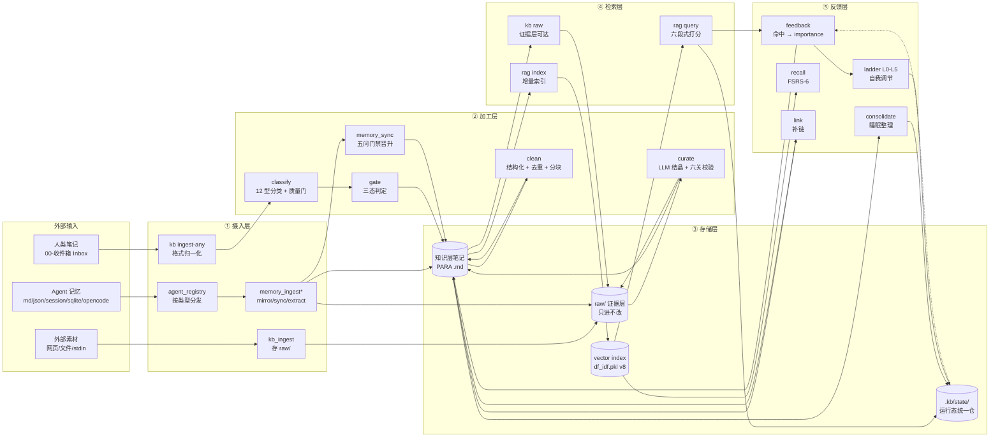

---

## 1. 摄入：数据怎么进来

### 1.1 人类笔记 → 统一摄取

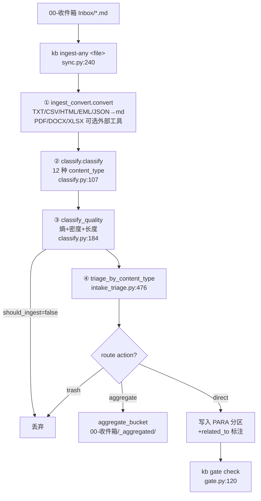

**关键落点**（`template-vault/pipeline/sync.py`）：

| 步 | 行为 | 证据 |
|---|---|---|
| ① 归一化 | `convert(src, root/"raw"/"_mirror")` → `ConvertResult.markdown`；失败按纯文本 `errors="replace"` 读 | `sync.py:254-261` |
| ② 分类 | 信号词从 `reference/content-type-signals.json` 加载，缺失回退内置默认 | `classify.py:57` |
| ③ 质量门 | `nchars<15` 或（密度<0.05 且 <200 字）→ noise 丢弃 | `classify.py:201-204` |
| ④ 路由 | content_type 优先（policy/decision/lesson/knowledge/reference 直达），chat 系列进聚合桶，其余按 `domain→PARA` | `intake_triage.py:436-504` |
| 写入 | 写前 `checkpoint()`；`related_to` 按余弦 0.70–0.92 最多标 3 篇 | `sync.py:294-376` |

**四张必须一致的 domain→PARA 路由表**（`tests/test_route_consistency.py` 守卫）：
`intake_triage._domain_to_para` · `memory_sync.FOLDER_TARGET` · `memory_ingest.DOMAIN_BUCKET` · `sync.DOMAIN_TARGET`
→ 开发/安全/运维/数据 → `20-技术 Technology`；产品/综合 → `40-资源库 Resources`；管理 → `10-项目 Projects`。

### 1.2 Agent 记忆 → 六种形态适配

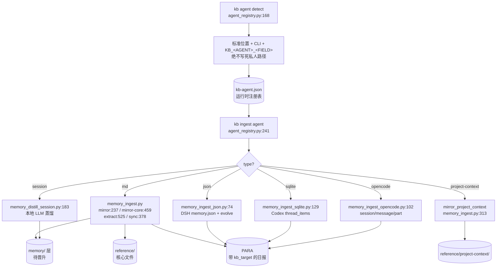

**五条共同纪律**（每个 adapter 都实现）：

1. `_safe_kb_path()` 拒绝路径穿越（绝对路径 / `../` 越界一律跳过）
2. 去重键带**内容指纹**（`sha1(full)[:12]`），修掉「同标题新内容被永久丢弃」
3. `dry_run` 严格只读：不写文件、不写 state、不 commit
4. 只 `git add` 本次新建/被改的文件，**绝不 `git add -A`**
5. 写 `logs/ingest_audit.log` 审计

**幂等键**：`memory_ingest` 用物理路径+mtime；`memory_ingest_json` 用 `dsj_seen_<name>`；`sqlite/opencode` 用 `type|domain|title|fingerprint`。

### 1.3 外部素材 → 不可变证据层

`kb_ingest`（`_research/kb_ingest.py`）：`--url` / `--file` / `--stdin` / `--dir` 四入口 → `raw/<domain>/<slug>.md`，带 `is_source=true` / `source_hash`。按 `source_hash` 幂等去重。**这是 RSI 外部接地阀的真实数据来源**（`external_inflow` 指标）。

---

## 2. 加工：数据怎么变成可用知识

### 2.1 收件箱四维 triage

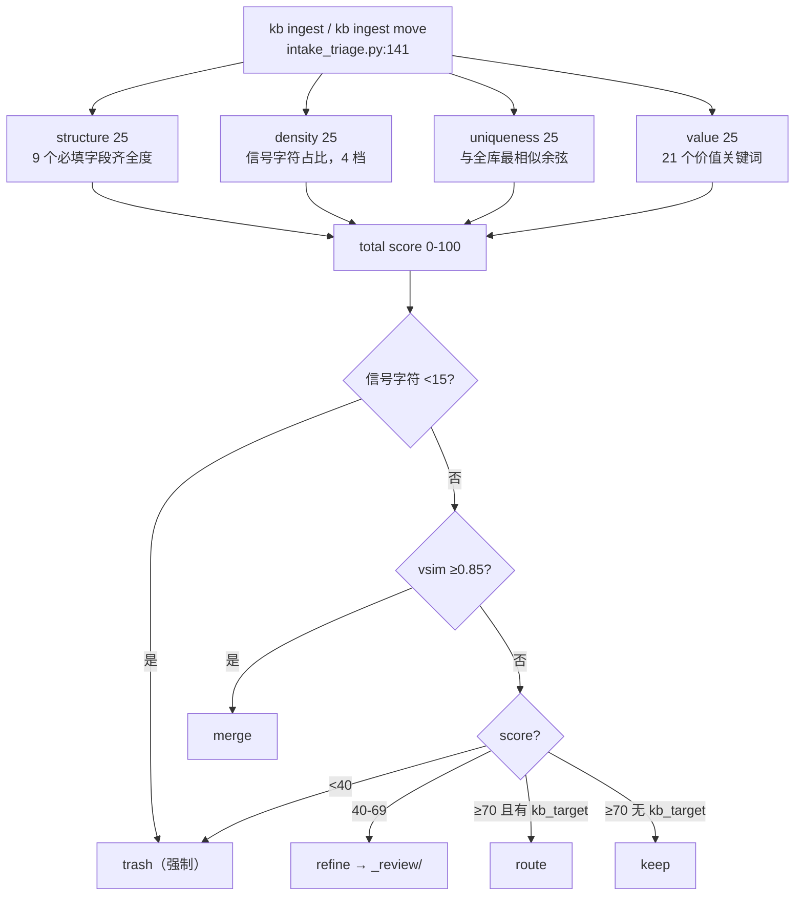

配置全部外置：`reference/triage-config.json`（weights / thresholds / merge_sim_threshold / value_keywords）。

**写操作（`apply_moves`，`intake_triage.py:300`）**：
- `route` → 挪到目标区，同步改写 frontmatter 的 `kb_target`（否则下一轮仍按旧区判据）
- `merge` → 正文并入目标 + `<!-- merged:rel -->` 标记 + 目标笔记加别名（旧 `[[src]]` 链接重定向）+ 墓碑（`redirect_to`）+ `record_lineage`
- `trash` → `90-归档 Archive/_trash/`；`refine` → `70-知识治理 Governance/_review/`
- `_safe_place()` 同名不同内容**改名避让，绝不覆盖**
- 全部精确 `git add` + 一条可回滚 commit

### 2.2 写入前门禁（gate）

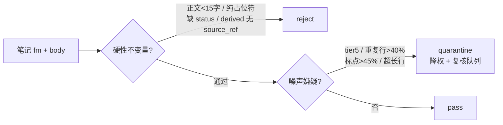

设计取舍（`gate.py:1-28`）：**reject 只用于不变量**，噪声一律 quarantine —— 个人库里「误拒不可恢复、误收可用降权挽回」。

`source_tier` 5 级：1 官方/规范 · 2 同行评议 · 3 工程博客 · 4 个人笔记 · 5 LLM 生成。

### 2.3 清洗与分块（clean）

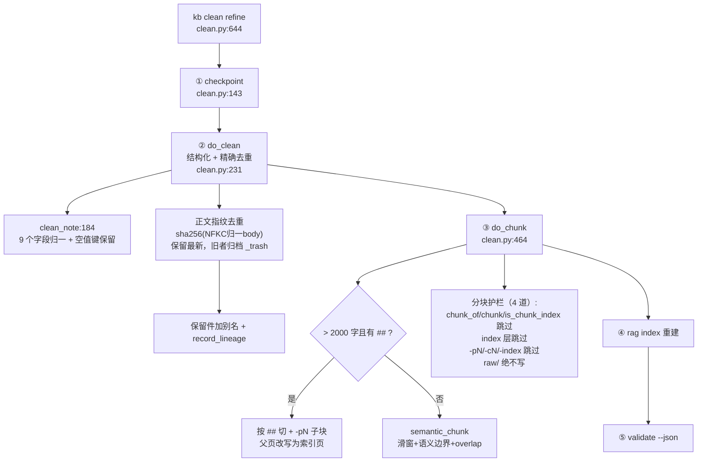

**四道分块护栏**（`clean.py:474-490`）就是为了杜绝生产库上出现过的 `-p2-p2` 级联膨胀。

### 2.4 知识结晶（curate）—— 最有含金量的一段

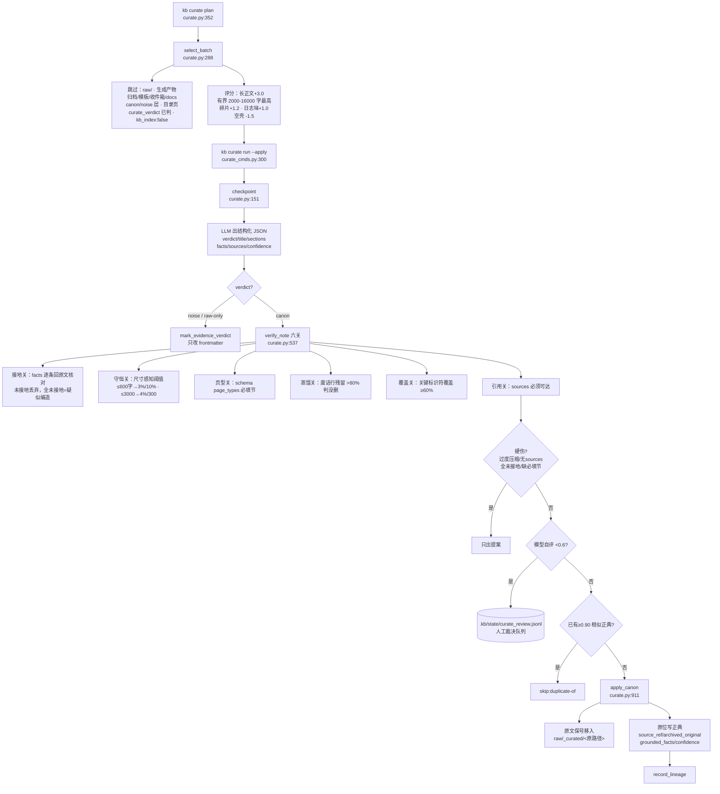

**L4 冻结闸**：`l4_frozen()`（`curate.py:830`）—— lc rung 被真人连续判错 → 本轮只出提案，不自动写回。

**双时态字段**：`event_at`（事实何时为真）与 `derived_at`（何时学到）分开存，`curate.py:690`。

### 2.5 记忆晋升（memory_sync 五问）

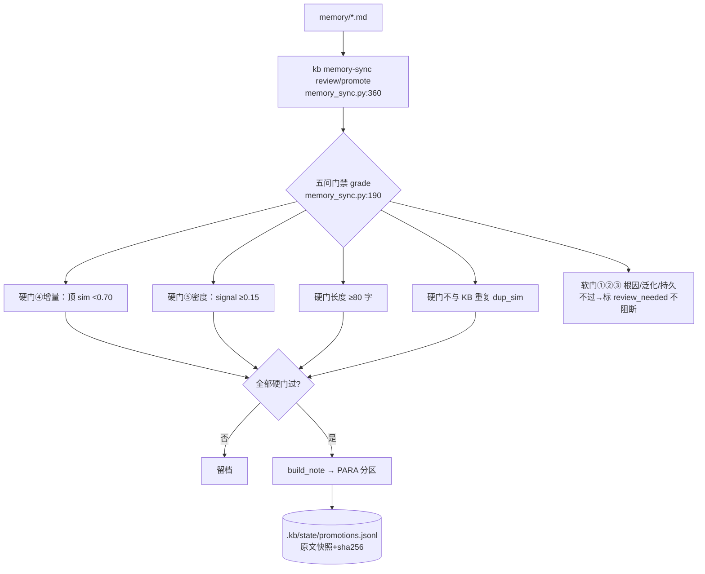

**致命细节**：`best_match(..., exclude=rel)` —— 不排除自身会恒匹配到自己（sim≈1.0），导致晋升通路**从未成功过**（修后 0→133 条）。`status: staged` 的原始会话轮永不晋升。

---

## 3. 存储：数据存在哪

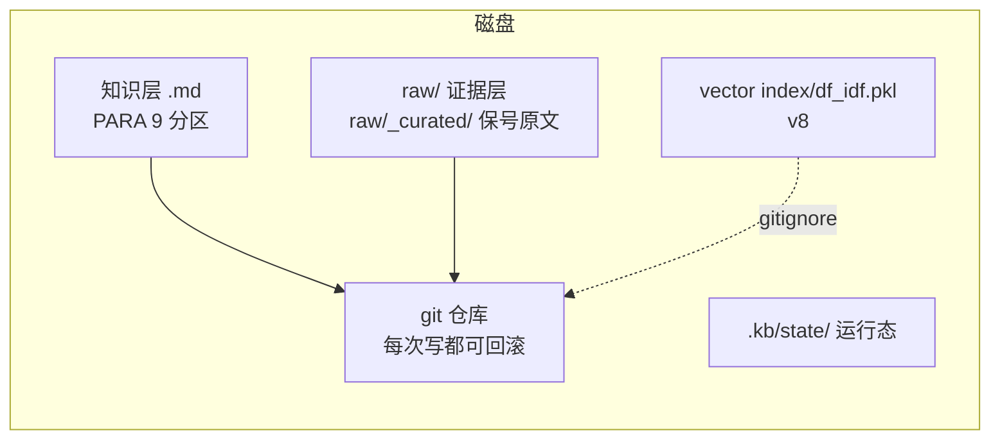

### 3.1 状态文件全景（`.kb/state/`，单一写路径）

| 文件 | 写入方 | 读取方 | 内容 |
|---|---|---|---|
| `feedback_state.json` | `rag_query._record_hits` / `feedback_loop` | feedback / kb_usage / L2 | `agent_hits`（每查询事件）+ `hits`（衰减计数）+ `explicit_feedback` |
| `recall_state.json` | `recall_schedule.mark` | recall / kb_health KPI | FSRS 的 S/D/reps/lapses/interval/ease |
| `query_cache.json` | `rag_query`（TTL 5min） | rag_query | 查询结果缓存（`--no-record` 时不读不写） |
| `curate_state.json` / `curate_ledger.jsonl` / `curate_proposals.jsonl` / `curate_review.jsonl` | curate | curate verify/report/recheck/review | 结晶进度、账本、完整提案、人工队列 |
| `kb_consolidate_state.json` / `kb_consolidate_proposals.json` | consolidate | consolidate status | 签名缓存、stale/gate 缓存、四阶段提议 |
| `claims.json` | kb_claim | consolidate / L3 | 可证伪声明 + 槽位 + 时间区间 + verdict |
| `kb_retrieval_adjust.json` | adjudicate / kb_adaptretrieve | **rag_query 运行时消费** | L1 检索修正契约 |
| `kb_l4_verdicts.jsonl` / `kb_l4_config.json` | kb_l4 | kb_l4 / curate | 真人裁决账本、冻结配置 |
| `kb_l5_state.json` / `kb_l5_policy.json` | kb_l5 | 调度器 | rung running score、激活权重 |
| `kb_engine_proposals.jsonl` | kb_engine | T3 A/B 快照 | 决策日志（含 fitness/health/scale/集中度） |
| `kb_rsi_proposals.jsonl` | kb_rsi | — | 只读探针的提议记录 |
| `kb_evolution.jsonl` + `pipeline/EVOLVED.md` | evolution_log | 人/机双读 | 统一演进日志 |
| `lineage.jsonl` | kb_metautil.record_lineage | audit | 合并/去重的 from→to 血缘 |
| `promotions.jsonl` | memory_sync | kb_drift / kb_consistency | 晋升审计（原文快照 + sha256） |
| `kb-agent.json` | agent_registry | ingest 分发 | Agent 注册表 |
| `install-manifest.json` | create_vault | scripts/verify.py | 安装基线清单 |

**统一机制**（`state_manager.py:23`）：`StateStore` + fcntl 文件锁 + `atomic_write_text`（临时文件→`os.replace`）；`LEGACY_PATHS`（`state_manager.py:238`）**40 条**旧路径只读回退 —— 升级不丢状态。

### 3.2 向量索引（`vector index/df_idf.pkl`，v8）

```json
{
  "version": 8, "n_docs": N,
  "vocab": [...], "idf": {...},
  "postings": {"词": [doc_id, tf, doc_id, tf, ...]},
  "docs": ["rel0", "rel1", ...],
  "norms": {...}, "dl": {...}, "avgdl": ...,
  "inverted_index": {"tag": {}, "domain": {}, "content_type": {}, "author": {}, "kb_summary_token": {}},
  "doc_hashes": {...}, "doc_mtimes": {...},
  "dense": {"dim": 256, "dim_in": 4096, "seed": 20261016, "vecs": {rel: array('f')}}
}
```

- `postings` 扁平数组：df = `len//2`，省掉重复存 df
- `_SafeUnpickler` 白名单（`rag_index.py:56`）：只允许 `Counter` + `array`，一个可写文件 ≠ 任意代码执行
- `save_index` 先原子写 `.pkl` 再删旧 `.json`（中途失败旧索引仍在）

---

## 4. 检索：问题怎么变成答案

### 4.1 索引构建（`rag_index.py:216`）

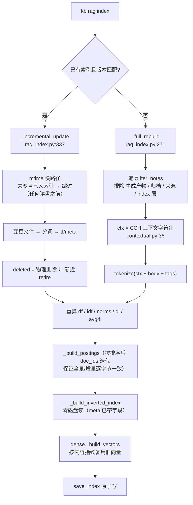

**三条路径逐位一致**（`rag_index.py:445`）：`_doc_norm` 按词排序后求和，保证全量重建 / 增量更新 / `all_doc_vectors` 的范数一致 —— 否则并列项会翻转名次、评测基线不可复现。

### 4.2 查询打分（`rag_query.cmd_query`，16 工序）

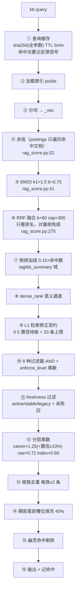

**为什么倒排加成是加性的**（`rag_score.py:142-159`，30 题黄金集实测）：

| 实现 | top1 | recall@10 | MRR |
|---|---|---|---|
| **现状（加性 0.15×n）** | **90.0%** | **98.3%** | **0.950** |
| 改乘性 + IDF 加权封顶 | 60.0% | 55.0% | 0.684 |
| 去掉加成 | 56.7% | 45.8% | 0.632 |
| 加性 + IDF 加权 | 80.0% | 94.2% | 0.892 |
| 剔除单字 CJK token | 80.0% | 83.3% | 0.883 |

原因：本库的 `tag`/`kb_summary` 是**人工标注的主题词**，命中它比命中正文普通词强得多；IDF 加权恰好会压掉「常见但正是主题词」的 token。

### 4.3 稠密通道为什么是"尾部填充"而不是 RRF

`tests/probe_semantic_gap.py` 实测（真实库 16 题改写式查询）：纯词法命中源笔记 **6/16=38%**，稠密 **15/16=94%**，**62% 的情况只有语义通道能找到**。

但把稠密混进头部是负增益（`KB_RERANK=embed`：top1 90.0%→86.7%）。所以 `dense_fill_tail`（`rag_score.py:305`）：词法前 60% **按构造不变**，其余槽位给稠密-only 笔记 —— 头部指标**不可能**回退。

---

## 5. 反馈：知识库怎么越用越好

### 5.1 反馈回路（importance 只升）

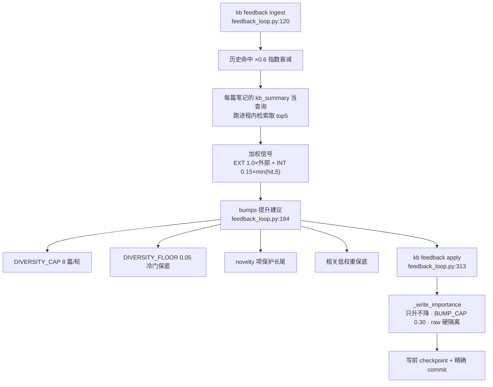

### 5.2 回忆调度（FSRS-6）

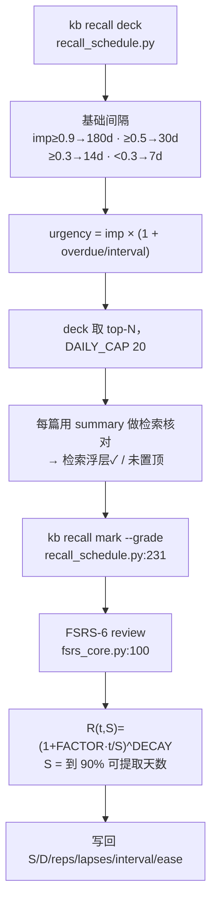

四档评分：`again/hard/good/easy` → `1/2/3/4`（**不是** SM-2 的 1/3/4/5，改错方向会让难度 D 反向更新）。

### 5.3 补链（多信号闸）

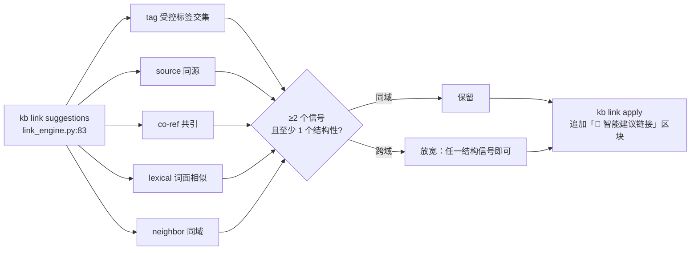

依据：噪声边沿图传播会被放大，而漏一条边几乎零成本 —— 个人库里「该连没连」只是少一次发现，「连错了」会让图遍历、MOC、检索都带错关联。

### 5.4 L0–L5 自我调节阶梯

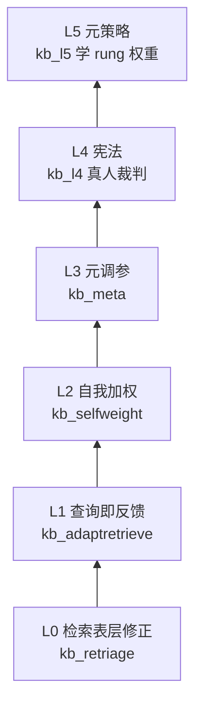

| 级 | 输入信号 | 产出 | 安全边界 |
|---|---|---|---|
| L0 | L1 的漏检缺口 token | 只增型 tags/kb_summary 提议 | 单篇 ≤12 tags、idf≥2.5、总数 ≤50 |
| L1 | `agent_hits` 里短期再问 | 检索修正契约提案 | apply 必须人工；黄金集实测坏契约 top1 90%→76.7% |
| L2 | 外部 useful > 再问 > RAG 人气(封顶) > 入链 | importance 提升提议 | 只升不降、BUMP_CAP 封顶 |
| L3 | `kb_usage` 漏检数 | 调 L0/L2 的阈值旋钮 | 单步、连续 2 次负 delta 回滚 |
| L4 | 真人逐条裁决 l0/l1/l2/l3/lc | 冻结/解冻某级 | 连续错 ≥3 且样本 ≥5；unfreeze 必须人工 |
| L5 | 阶梯活动 vs 真实结果趋势 | rung 激活权重 | score ±0.25 单步、weight ≥0.05 不归零 |

**共同铁律**：外部锚最硬 + **接地阀**（新鲜外部源 <5% 或跨域 <15% → 冻结内部自改）。

`kb ladder adjudicate`（`adjudicate.py`）：L1 是**双闸**（LLM 语义相关 **且** 实测「加契约前后目标排名真的变好」），L2/L3 只有 LLM 判断但靠硬边界 + 全量账本兜底；**裁判不可用 → 不裁决**。

---

## 6. 旁路：那些不进主链路但必须存在的

### 6.1 睡眠时整理（consolidate）

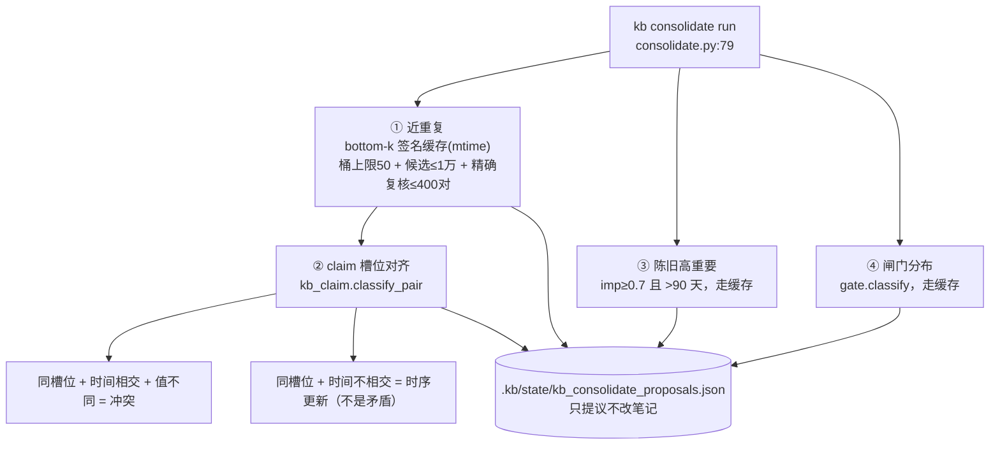

首跑曾 >10 分钟卡死，三处性能修复：签名缓存、桶上限 50（防「的就是」这类高频片段桶内两两枚举百万对）、全局候选上限必须在 `bottomk_similarity` **之前**判断。

### 6.2 矛盾在环（contradict）

主题重合（Jaccard≥0.25）+ 变更信号词 → 冲突候选；同族/同源跳过；overlap≥0.85 判「近似重复」（**应合并不是标冲突**）。`apply` 写 `conflicts_with`（合并不覆盖）+ 正文 callout + 人工队列。

### 6.3 复合置信分（confidence）

`confidence = 抽取方式×0.50 + 佐证数×0.25 + 新近×0.15 + 校验通过×0.10`

- extraction：按 `^[推断]` 标记占比连续插值（0%→0.9，≥50%→0.6）
- corroboration：`min(1.0, 0.35 + 0.65·log2(n)/3)`（1→0.35，8+→1.0）
- recency：90 天内 1.0，线性衰减到 1 年 0.15
- **绝对档 + 相对档**：绝对阈值分不开（正典天然集中 0.75–0.84），用群体 p10/p3 做相对分档

`kb decay` = 原则性遗忘：零命中 + 陈旧 + 低重要 + 低置信 命中 3 项 → 建议降层，**只降层从不删文件**。

### 6.4 RSI 研究层

| 模块 | 作用 | 关键约束 |
|---|---|---|
| `kb_rsi` | 只读探针 → 改进提议 | 外部接地防塌阀 + importance 集中度护栏（Simpson/Shannon/单篇占比） |
| `kb_engine` | T1 整理 / T2 加权 / T3 调参 | T3 默认关；连续 3 次负 delta 自动回滚 |
| `kb_fitness` | **外部锚定 fitness** | 专治 T3「优化系统能自抬的数字」的 Goodhart 闭环 |
| `kb_usage` | 再问率（1h 窗口 + 0.55 相似度） | 只读；`mark` 才写 |
| `kb_claim` | 可证伪声明验证 | **日期硬约束**：只让后来的数据检验过去的声明 |

`_research/` 目录结构本身就是「内部实验代码」的声明，`tests/test_reachability.py` 强制：每个模块要么接线、要么在 `_research/`、要么在手写例外清单（≤3 条）。

---

## 7. 治理与运维

### 7.1 每日编排（cron）

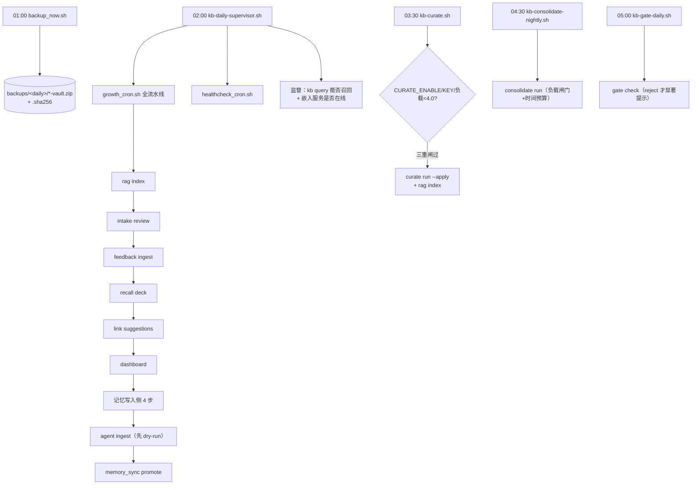

所有 cron 脚本**退出码恒 0**（让简报一定投递出去），问题在正文用 ❌/⚠️ 标注；`growth_cron.sh` 每步独立隔离（单步失败不中断）。

### 7.2 巡检 9 项（`kb healthcheck`）

| 巡检项 | 关键判断 | 已知坑 |
|---|---|---|
| deadlinks | Obsidian 语义：aliases / H1 标题 / 裸名跨命名空间都算可达；先剥代码块（`[[...]]` 是语法示例） | 曾漏报 15 条（含 `/` 路径直接返回"不算缺失"） |
| skeletons | <500B 且 >7 天，排除运行产物 `_graph_kg-c1.md` / `_audit/log.md` | 曾把这些报成骨架 |
| tags | 两套词表都认（`taxonomy.json` + `tag-taxonomy.json` + 内置白名单） | 只看一套会误报 145 种 |
| empty / frontmatter / discipline | 目录纪律、必填字段、顶层 `NN-` 编号 | |
| overlong | >2000 字且未分块（导航页/已分块产物豁免） | |
| orphans | **出链与入链都没有**才算孤儿；证据层不算；导航页（提供入链）必须纳入扫描 | 只看出链 → 虚高到 2903 |
| freshness | `review_after` 到期 或 updated >180 天；非可检索状态 | |

### 7.3 抗 Goodhart 的 5 个 KPI（`kb health-metrics --kpi`）

① 两跳可达覆盖率 ② 检索一次命中率 ③ 预测校准 Brier ④ 高重要陈旧率 ⑤ 复用率（入链覆盖）
—— 只算**难刷**的量；笔记数/链接总数明确标注「仅诊断、勿当 KPI」。

### 7.4 一行验收（`kb verify`）

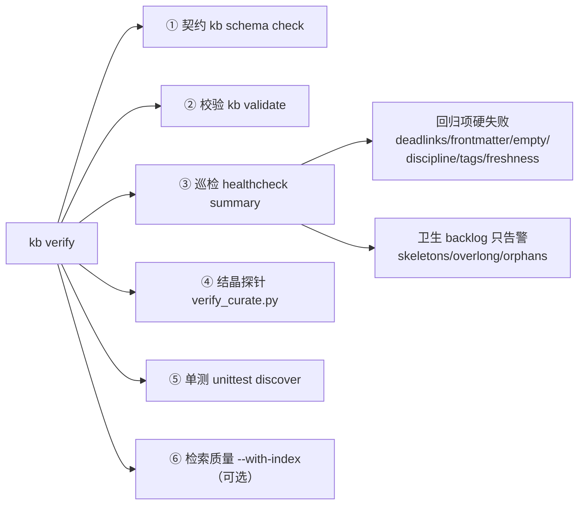

**为什么分开**：卫生 backlog 混进回归闸门 → 闸门天天红 → 连续失败 10 次被自动 disable → 从此**没有任何每日验收**（实测发生过，停了 5 天）。

---

## 8. 一页速查：数据去了哪

| 你的动作 | 数据路径 | 落盘位置 | 可否回滚 |
|---|---|---|---|
| 往收件箱丢笔记 | Inbox → ingest-any → gate → PARA | 知识层 `.md` | git（写前 checkpoint） |
| `kb rag index` | 知识层 → 分词 → postings | `vector index/df_idf.pkl` | 是（派生缓存，随时重建） |
| `kb query` | 索引 → 打分 → 命中 | `.kb/state/query_cache.json` + `feedback_state.json` | 是（`--no-record` 可完全关闭） |
| `kb ingest agent` | Agent 源 → adapter → KB | `memory/` / `PARA` / `reference/` | 是（精确 add + commit） |
| `kb memory-sync promote` | `memory/` → 五问 → PARA | 知识层 `.md` + `promotions.jsonl` | 是（baseline 记录在案） |
| `kb curate run --apply` | 知识层 → LLM → 六关 → 正典 | 正典原地 + 原文入 `raw/_curated/` | 是（checkpoint + lineage） |
| `kb clean refine` | 清洗 → 去重 → 分块 → 索引 | 知识层 + `-pN` 子块 + 索引 | 是。**绝不写 raw/** |
| `kb consolidate run` | 全库 → 四阶段分析 | `.kb/state/*proposals.json` | **不改任何笔记** |
| `kb backup daily` | 全库 → zip | `backups/daily/<date>-vault.zip` + `.sha256` | 是人肉恢复源 |

---

## 9. 设计哲学（贯穿全部代码）

1. **拒绝不可逆，放过可挽回**：gate 只用 reject 挡不变量；噪声走 quarantine；遗忘只降层不删文件
2. **raw/ 永远只进不改**：任何模块改写 raw/ 前都有 `is_raw_path` 守卫
3. **默认只提议**：consolidate / ladder / rsi / adaptretrieve 全部只产提案，写入必须人工 apply
4. **写前 checkpoint + 精确 git add**：绝不 `git add -A`，永不 sweep Obsidian 运行时态
5. **best-effort 降级**：LLM/embedding 不可用时静默缺席，主链路绝不因增强项挂掉
6. **用实测数字对抗直觉**：倒排加成、dense 尾部填充、语义重排默认关 —— 每处都有黄金集数据和"改坏了会怎样"
7. **可证明等价才合并**：范数按词排序求和、全量/增量/查询三路径逐位一致
8. **外部锚最硬**：所有自我改进（L0–L5 / T1–T3 / RSI）都必须有 raw/ 新鲜流入或真人裁决做锚，防 Goodhart 与 Model Collapse

---

*本文档由代码通读生成（约 1.8 万行生产模块 + 6903 行研究层），引用行号对应 `94e6743`。*
